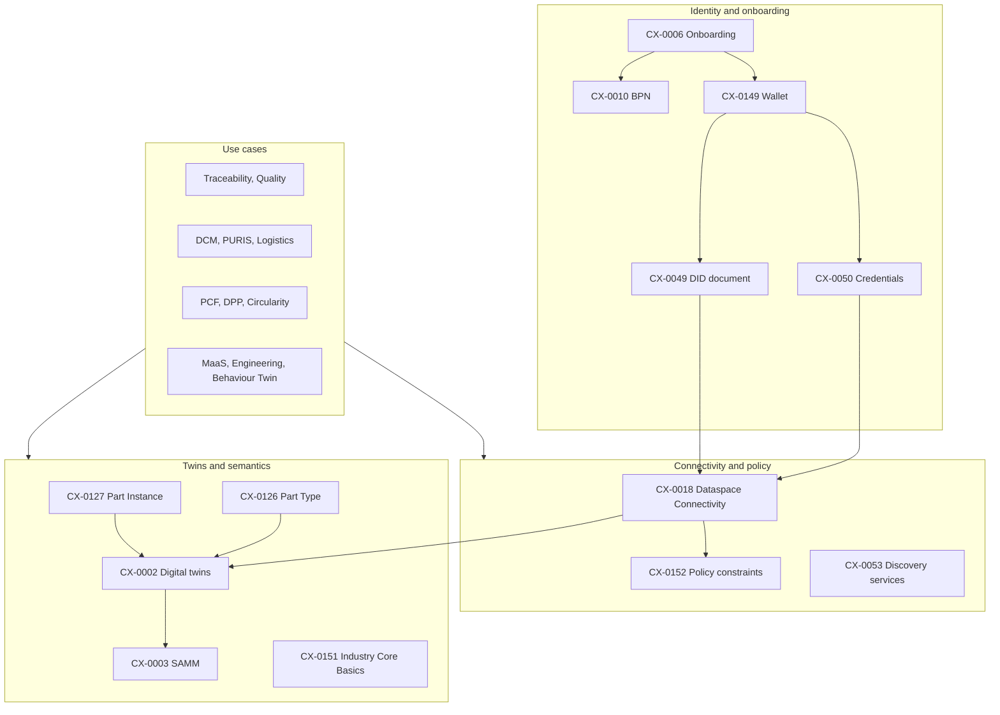

# Catena-X Standards: A Summary of CX-Titan

As of 25 October 2026 · CX-Titan (current release), with notes on the CX-Neptune preview

## 1. How to use this summary

This document summarises every standard in the current Catena-X release, CX-Titan: all 58 standards listed on the [standards overview](https://catenax-ev.github.io/docs/standards/overview). Each one was read in its source form in the [Catena-X website repository](https://github.com/catenax-ev/catenax-ev.github.io) (snapshot of 14 October 2026). Each summary says what the standard is for, who must comply, its key requirements, what it builds on, and its status in the upcoming CX-Neptune release. The summaries are ours; when a detail matters for certification or implementation, the standard's own text wins, and every entry links to it.

Sections 2–4 explain how Catena-X standards work, list all 58 on one page, and show how they depend on each other. Sections 5–15 contain the summaries, grouped by area; the grouping is ours, not the association's. Section 16 covers what changes with CX-Neptune, and section 17 maps the standards onto our own products. For the protocols underneath the connector standards, see the [DSP guide](dataspace-protocol-guide.md) and the [DCP guide](decentralized-claims-protocol-guide.md); the [primer](Catena-X%20%26%20Tractus-X%20Backend%20Team%20Primer.md) explains the ecosystem around them.

## 2. How Catena-X standards work

**What they are for.** The standards are the rulebook for certification. They give independent implementations uniform requirements so they interoperate, and Conformity Assessment Bodies (CABs) assess solutions against them. A certification is always for a **role** (for example Enablement Service Provider, Business Application Provider or Core Service Provider) and a **module** (for example Connector, Traceability or MaaS). Each role and module requires its own set of standards ([overview](https://catenax-ev.github.io/docs/standards/overview)). The `tags` on each standard page, such as `CAT/Connector` or `UC/Traceability`, show which modules a standard belongs to.

**Releases.** Standards are published in named releases: CX-Jupiter, CX-Io, CX-Saturn, CX-Titan (current) and CX-Neptune (preview, going live at the end of November 2026). CX-Titan is fully compatible with CX-Saturn. When CX-Neptune goes live, CX-Jupiter is deprecated and all certifications of Jupiter-based solutions expire ([Neptune overview](https://catenax-ev.github.io/docs/next/standards/overview)).

**How a standard is built.** Almost all follow one template:

- An abstract, plus an "Audience & scope" section naming the roles concerned.
- "Context and architecture fit".
- "Conformance and proof of conformity", which says what a CAB will check.
- The normative main content, usually aspect models (SAMM data models), APIs (as OpenAPI specifications) and processes.
- References.

Sections marked non-normative are explanation only; everything else is binding, with MUST, SHOULD and MAY used as in RFC 2119.

**Use-case standards bundle others.** A use-case standard, such as Traceability, PCF or DCM, lists the standalone standards a participant must also meet, then adds its own models and APIs. A data provider or consumer can meet a use-case standard in two ways: by using an app certified for that use case, in which case no further proof is needed, or by proving conformity with every listed standard itself.

**Patterns that recur everywhere**, so the summaries below do not repeat them each time:

- Data moves only through a connector conforming to **CX-0018**, and only after a successful contract negotiation, under policies following **CX-0152**.
- Data is offered as digital twins (Asset Administration Shells, **CX-0002**) with submodels described by SAMM aspect models (**CX-0003**), identified by `urn:samm:io.catenax...` URNs and published in the Semantic Hub.
- Physical parts reuse the Industry Core twins (**CX-0126** for types, **CX-0127** for instances), and push-style messages reuse Industry Core notifications (**CX-0151**).
- Connector assets carry a `dct:type` from the Catena-X taxonomy and a `cx-common:version` (**CX-0018**).
- Participants are identified by BPN (**CX-0010**) in business terms and by DID (**CX-0049**, **CX-0149**) on the wire.

## 3. All standards at a glance

| Standard | Version | Area | In one line |
| --- | --- | --- | --- |
| [CX-0001](https://catenax-ev.github.io/docs/standards/CX-0001-ParticipantAgentRegistration) Participant Agent Registration | 1.2.1 | Onboarding | Register each connector with the CSP-B and give it a Gaia-X Self-Description |
| [CX-0002](https://catenax-ev.github.io/docs/standards/CX-0002-DigitalTwinsInCatenaX) Digital Twins in Catena-X | 2.4.0 | Twins and semantics | Digital Twin Registry and submodel APIs (AAS) and how they are offered through the connector |
| [CX-0003](https://catenax-ev.github.io/docs/standards/CX-0003-SAMMSemanticAspectMetaModel) SAMM Aspect Meta Model | 1.3.0 | Twins and semantics | SAMM as the modelling language for all aspect models |
| [CX-0005](https://catenax-ev.github.io/docs/standards/CX-0005-ItemRelationshipServiceAPI) Item Relationship Service API | 2.2.0 | Twins and semantics | API of the Item Relationship Service that walks BOM data chains |
| [CX-0006](https://catenax-ev.github.io/docs/standards/CX-0006-RegistrationAndInitialOnboarding) Registration and Initial Onboarding | 2.1.0 | Onboarding | The onboarding process from OSP request to membership credential |
| [CX-0007](https://catenax-ev.github.io/docs/standards/CX-0007-MinimalDataProviderServicesOffering) Minimal Data Provider Service Offering | 1.1.1 | Twins and semantics | Minimum requirements for one-off data upload tools |
| [CX-0009](https://catenax-ev.github.io/docs/standards/CX-0009-CXRegistrationAPI) CX Registration API | 2.0.0 | Onboarding | Registration API of the Core Service Provider |
| [CX-0010](https://catenax-ev.github.io/docs/standards/CX-0010-BusinessPartnerNumber) Business Partner Number | 3.0.1 | Business partner data | Structure, issuance and lifecycle of the Business Partner Number |
| [CX-0012](https://catenax-ev.github.io/docs/standards/CX-0012-BusinessPartnerDataPoolAPI) Business Partner Data Pool API | 5.1.1 | Business partner data | API of the BPDM Pool of Golden Records |
| [CX-0018](https://catenax-ev.github.io/docs/standards/CX-0018-DataspaceConnectivity) Dataspace Connectivity | 4.2 | Connectivity | The connector standard: DSP, DCP, transfer types, dataset and discovery conventions |
| [CX-0044](https://catenax-ev.github.io/docs/standards/CX-0044-ECLASS) ECLASS | 1.0.2 | Twins and semantics | Use ECLASS semantics wherever they exist |
| [CX-0045](https://catenax-ev.github.io/docs/standards/CX-0045-AspectModelDataChainTemplate) Aspect Model Data Chain Template | 1.3.0 | Twins and semantics | Template for aspect models that link twins into data chains |
| [CX-0049](https://catenax-ev.github.io/docs/standards/CX-0049-DIDDocumentSchema) DID Document | 2.3.0 | Onboarding | Required content of a participant's DID document |
| [CX-0050](https://catenax-ev.github.io/docs/standards/CX-0050-CXSpecificCredentials/CX-0050-CatenaXSpecificVerifiableCredentials) Catena-X-specific Verifiable Credentials | 2.2.1 | Onboarding | The four Catena-X credential types and their schemas |
| [CX-0053](https://catenax-ev.github.io/docs/standards/CX-0053-BPNDiscoveryServiceAPIs) Discovery Finder and BPN Discovery Service APIs | 1.1.1 | Connectivity | Discovery Finder and BPN Discovery services |
| [CX-0054](https://catenax-ev.github.io/docs/standards/CX-0054-ApplicationServiceRelease) Application Service Release | 1.0.1 | Onboarding | Release process for apps and services on the marketplace |
| [CX-0055](https://catenax-ev.github.io/docs/standards/CX-0055-DataProcessingPatternsforITSystemIntegration) Data Processing Patterns for IT System Integration | 1.2.0 | Twins and semantics | Certification of IT-system integration solutions by data processing pattern |
| [CX-0059](https://catenax-ev.github.io/docs/standards/CX-0059-UseCaseBehaviourTwinEndurancePredictor) Use Case Behaviour Twin Endurance Predictor | 2.0.1 | Behaviour Twin | Remaining useful life from measured load spectra |
| [CX-0067](https://catenax-ev.github.io/docs/standards/CX-0067-OntologyModelsToRealizeFederatedQueryInCatenaX) Ontology Models to Realize Federated Query in Catena-X | 1.1.0 | Twins and semantics | Ontology modelling rules for Knowledge Agents |
| [CX-0074](https://catenax-ev.github.io/docs/standards/CX-0074-BusinessPartnerGateAPI) Business Partner Gate API | 4.1.1 | Business partner data | API of the BPDM Gate for sharing partner data |
| [CX-0076](https://catenax-ev.github.io/docs/standards/CX-0076-GoldenRecordEndtoEndRequirementsStandard) Golden Record End-to-End Requirements Standard | 1.5.0 | Business partner data | Quality rules a Golden Record must meet |
| [CX-0077](https://catenax-ev.github.io/docs/standards/CX-0077-DataQualityDashboard) Data Quality Dashboard | 1.2.2 | Business partner data | Dashboard for business partner data quality |
| [CX-0078](https://catenax-ev.github.io/docs/standards/CX-0078-BankDataVerificationDashboard) Bank Data Verification Dashboard | 1.2.2 | Business partner data | Verification of business partners' bank data |
| [CX-0079](https://catenax-ev.github.io/docs/standards/CX-0079-NaturalPersonScreeningDashboard) Natural Person Screening Dashboard | 1.2.2 | Business partner data | Screening for natural persons in partner data |
| [CX-0080](https://catenax-ev.github.io/docs/standards/CX-0080-BPDMFraudPreventionService) BPDM Fraud Prevention Service | 1.1.1 | Business partner data | Shared database of reported fraud cases |
| [CX-0081](https://catenax-ev.github.io/docs/standards/CX-0081-BPDMCountryRisk) Country Risk API | 1.2.1 | Business partner data | Country risk scores and their sharing API |
| [CX-0084](https://catenax-ev.github.io/docs/standards/CX-0084-FederatedQueriesInDataSpaces) Federated Queries in Data Spaces | 1.2.0 | Twins and semantics | Knowledge Agents: federated queries and compute-to-data |
| [CX-0105](https://catenax-ev.github.io/docs/standards/CX-0105-AssetTrackingUseCase) Asset Tracking Use Case | 1.1.0 | Supply chain | IoT sensor data and asset tracking |
| [CX-0115](https://catenax-ev.github.io/docs/standards/CX-0115-ManufacturingCapabilityExchange) Manufacturing Capability Exchange | 1.0.1 | MaaS | Manufacturing capability model and exchange |
| [CX-0116](https://catenax-ev.github.io/docs/standards/CX-0116-SanctionWatchlistDashboard) Sanction Party Watchlist Dashboard | 1.2.2 | Business partner data | Screening partners against sanction watchlists |
| [CX-0117](https://catenax-ev.github.io/docs/standards/CX-0117-UseCaseCircularEconomySecondaryMarketplace) Use Case Circular Economy – Secondary Marketplace | 1.0.0 | Sustainability | Secondary marketplace for used parts, starting with batteries |
| [CX-0123](https://catenax-ev.github.io/docs/standards/CX-0123-QualityUseCaseStandard) Quality Use Case Standard | 3.0.2 | Quality | Quality use case: field and production quality data |
| [CX-0125](https://catenax-ev.github.io/docs/standards/CX-0125-TraceabilityUseCase) Traceability Use Case | 2.3.1 | Traceability | Traceability use case with quality and block notifications |
| [CX-0126](https://catenax-ev.github.io/docs/standards/CX-0126-IndustryCorePartType) Industry Core: Part Type | 2.1.1 | Industry Core | Twins for part types and as-planned BOMs |
| [CX-0127](https://catenax-ev.github.io/docs/standards/CX-0127-IndustryCorePartInstance) Industry Core: Part Instance | 2.0.2 | Industry Core | Twins for part instances and as-built BOMs |
| [CX-0128](https://catenax-ev.github.io/docs/standards/CX-0128-DemandandCapacityManagementDataExchange) Demand and Capacity Management Data Exchange | 2.3.0 | Supply chain | Demand and capacity management, week-based |
| [CX-0129](https://catenax-ev.github.io/docs/standards/CX-0129-RequestforQuotationExchange) Request for Quotation Exchange | 2.0.1 | MaaS | Request for quotation exchange |
| [CX-0131](https://catenax-ev.github.io/docs/standards/CX-0131-CircularityCore) Circularity Core | 1.1.1 | Sustainability | Circularity core: secondary material, end-of-life, CE-Assistant |
| [CX-0133](https://catenax-ev.github.io/docs/standards/CX-0133-OnlineControlandSimulation) Online Control and Simulation | 2.0.1 | Supply chain | Exchange of material-flow simulation results and what-if scenarios |
| [CX-0135](https://catenax-ev.github.io/docs/standards/CX-0135-CompanyCertificateManagement) Business Partner Company Certificate Management | 2.4.0 | Business partner data | Company certificate management |
| [CX-0136](https://catenax-ev.github.io/docs/standards/CX-0136-UseCasePCF) Use Case PCF | 2.2.2 | Sustainability | Product Carbon Footprint exchange |
| [CX-0138](https://catenax-ev.github.io/docs/standards/CX-0138-UseCaseBehaviourTwinEnduranceEstimator) Use Case Behaviour Twin Endurance Estimator | 1.0.2 | Behaviour Twin | Remaining useful life from estimated loads |
| [CX-0141](https://catenax-ev.github.io/docs/standards/CX-0141-HealthIndicatorUseCase) Use Case Behaviour Twin Health Indicator | 1.0.1 | Behaviour Twin | Component health indicators via Knowledge Agents |
| [CX-0142](https://catenax-ev.github.io/docs/standards/CX-0142-ShopFloorInformationService) Shop Floor Information Service | 1.0.1 | Supply chain | Shop floor production forecasts and tracking data |
| [CX-0143](https://catenax-ev.github.io/docs/standards/CX-0143-UseCaseCircularEconomyDigitalProductPassportStandard/introduction) Use Case Circular Economy – Digital Product Passport | 1.4.0 | Sustainability | Digital Product Passport use case |
| [CX-0144](https://catenax-ev.github.io/docs/standards/CX-0144-ESSUseCaseStandard) ESS Use Case Standard | 1.0.1 | Sustainability | Environmental and social standards incident tracking |
| [CX-0146](https://catenax-ev.github.io/docs/standards/CX-0146-SupplyChainDisruptionNotifications) Supply Chain Disruption Notifications | 2.0.1 | Supply chain | Supply chain disruption notifications |
| [CX-0149](https://catenax-ev.github.io/docs/standards/CX-0149-WalletRequirements) Wallet Requirements | 2.0.0 | Onboarding | What makes a wallet Catena-X compliant |
| [CX-0150](https://catenax-ev.github.io/docs/standards/CX-0150-UseCaseLogistics) Logistics Use Case | 1.2.1 | Supply chain | Logistics: transport units and packing lists |
| [CX-0151](https://catenax-ev.github.io/docs/standards/CX-0151-IndustryCoreBasics) Industry Core: Basics | 1.1.0 | Industry Core | Industry Core basics and the common notification format |
| [CX-0152](https://catenax-ev.github.io/docs/standards/CX-0152-PolicyConstrainsForDataExchange) Policy Constraints for Data Exchange | 1.0.0 | Connectivity | Catena-X ODRL profile for access and usage policies |
| [CX-0153](https://catenax-ev.github.io/docs/standards/CX-0153-TariffsUseCase) Tariffs Use Case | 2.0.0 | Supply chain | Data for U.S. tariff declarations on steel and aluminium parts |
| [CX-0154](https://catenax-ev.github.io/docs/standards/CX-0154-MasterDataManagement) Digital Master Data | 1.0.1 | Engineering | Part master data during development |
| [CX-0155](https://catenax-ev.github.io/docs/standards/CX-0155-RequirementsEngineering) Requirements Engineering | 1.0.1 | Engineering | Engineering requirements exchange |
| [CX-0156](https://catenax-ev.github.io/docs/standards/CX-0156-Geometry) Geometry | 1.0.0 | Engineering | 3D and 2D geometry exchange |
| [CX-0157](https://catenax-ev.github.io/docs/standards/CX-0157-PURIS) Predictive Unit Real-Time Information Service (PURIS) | 1.0.0 | Supply chain | PURIS short-term supply collaboration |
| [CX-0158](https://catenax-ev.github.io/docs/standards/CX-0158-CarSBOM) Car SBOM | 1.0.0 | Engineering | Software bills of materials for cars |
| [CX-0159](https://catenax-ev.github.io/docs/standards/CX-0159-Material-Accounting) Material Accounting | 1.0.0 | Sustainability | Material accounting along the reverse value chain |

## 4. How the standards fit together

Read it bottom-up: every use case relies on the twin and semantics layer and on the connector and policy layer, and the connector relies on the identity layer. The business partner data standards (section 9) sit beside this stack: they provide the BPNs and Golden Records that everything else refers to.

## 5. Onboarding, identity and marketplace

How a company joins Catena-X, which identities and credentials it holds, and how apps reach the marketplace. Titan also has a non-numbered standard, CX-NFR-IdP Identity Proofing, which took over the identity proofing step from CX-0006 ([Titan changelog](https://catenax-ev.github.io/docs/standards/changelog)).

### [CX-0001 Participant Agent Registration](https://catenax-ev.github.io/docs/standards/CX-0001-ParticipantAgentRegistration) · v1.2.1

**Purpose.** Registers each participant agent (a connector that meets CX-0018) with the Core Service Provider B so it gets a Gaia-X compliant Self-Description of type `ServiceOffering`. It exists to meet Gaia-X compliance requirements.

**Applies to.** CSP-B, which must offer the registration workflow; Enablement Service Providers and Business Application Providers that bundle a connector, which must run the registration for their customers; data providers and consumers.

**Key requirements.**

- Every registered participant agent gets a Self-Description, made available by the CSP-B.
- Self-Descriptions must follow the Gaia-X Trust Framework version Catena-X supports, carry a compliance credential issued by Gaia-X AISBL, and be registered in a Self-Description store such as SD-Hub.
- The registered endpoint must be a CX-0018 connector endpoint.

**Builds on.** CX-0010, CX-0018.

**Neptune.** Not in the Neptune preview.

### [CX-0006 Registration and Initial Onboarding](https://catenax-ev.github.io/docs/standards/CX-0006-RegistrationAndInitialOnboarding) · v2.1.0

**Purpose.** The onboarding process a company goes through to join Catena-X. It starts with initial data given to an Onboarding Service Provider (OSP) and ends with a MembershipCredential in the company's wallet. Registration is mandatory and invitation-based: a company cannot register without a certified OSP or the CSP-B.

**Applies to.** CSP-B and Onboarding Service Providers.

**Key requirements.**

- The OSP collects at least the company name and full address, so the legal entity is unambiguous, and forwards it as a registration request to the CSP-B.
- The CSP-B collects further data, including the roles applied for (with a certificate of conformity from a CAB where a role needs one) and whether the company brings its own wallet or wants one provided.
- The CSP-B validates the data, ensures a BPNL exists, and runs identity proofing as defined in the separate Identity Proofing standard (CX-NFR-IdP).
- Every participant ends up with a wallet meeting CX-0149, and the CSP-B issues the membership credential into it.

**Builds on.** CX-0010, CX-0050, CX-0149.

**Neptune.** Same version number in the preview. In Titan, identity proofing moved out of this standard into CX-NFR-IdP.

### [CX-0009 CX Registration API](https://catenax-ev.github.io/docs/standards/CX-0009-CXRegistrationAPI) · v2.0.0

**Purpose.** The API behind the registration process in CX-0006: the endpoints a Core Service Provider exposes so that a registering company, or later an Onboarding Service Provider remotely, can submit and verify company data.

**Applies to.** Core Service Providers, with Onboarding Service Providers for reference.

**Key requirements.**

- The CSP must implement the endpoints for entering and verifying company data, selecting company roles and giving consent, uploading registration documents, and verifying and submitting the application. Paths may differ, but the business logic and attributes must be followed.
- Separate endpoints enable "partner network" registration by OSPs.
- A CSP with its own registration solution proves conformity with an OpenAPI specification of these endpoints.

**Builds on.** CX-0006.

**Neptune.** Same version number in the preview.

### [CX-0049 DID Document](https://catenax-ev.github.io/docs/standards/CX-0049-DIDDocumentSchema) · v2.3.0

**Purpose.** What a Catena-X participant's DID document must contain. DID documents are public: anyone who knows the DID can read the participant's public keys and service endpoints.

**Applies to.** Core Service Providers that provision wallets, and every participant, since each must have a compliant DID document.

**Key requirements.**

- The document must comply with W3C DID v1.0 and with the DCP v1.0 rules for DID documents.
- It must list a `CredentialService` entry pointing to a DCP Credential Service that is a CX-0149-compliant wallet.
- A `DataService` entry, where present, must point to the connector's DSP version metadata endpoint (`.../.well-known/dspace-version`).
- The document must follow the JSON schema in the standard. Keys appear as `JsonWebKey2020` verification methods, referenced from `authentication` and `capabilityInvocation`.

**Builds on.** DID Core, DCP 1.0, DSP 2025-1, CX-0050, CX-0149.

**Neptune.** Same version number in the preview.

### [CX-0050 Catena-X-specific Verifiable Credentials](https://catenax-ev.github.io/docs/standards/CX-0050-CXSpecificCredentials/CX-0050-CatenaXSpecificVerifiableCredentials) · v2.2.1

**Purpose.** Defines the four Catena-X credential types and their JSON schemas. All are issued by the CSP-B, or an issuer it assigns, and presented by participants through DCP.

**Applies to.** CSP-B as the issuer, and data providers and consumers who present and verify the credentials.

**Key requirements.** Each credential must follow its schema. The `credentialSubject` fields, all required, are:

| Credential | `credentialSubject` fields | Attests |
| --- | --- | --- |
| MembershipCredential | `id`, `memberOf`, `holderIdentifier` | The subject is a Catena-X member |
| BpnCredential | `id`, `bpn`, `holderIdentifier` | The subject owns this BPN |
| Framework agreement credential (type `DataExchangeGovernanceCredential` for the general framework) | `id`, `holderIdentifier`, `group` (always `UseCaseFramework`), `useCase`, `contractTemplate`, `contractVersion` | The subject signed a use-case framework agreement in a given version |
| DismantlerCredential | `id`, `holderIdentifier`, `activityType`, `allowedVehicleBrands` | The subject is a certified dismantler for the listed brands |

`holderIdentifier` carries the BPNL and `id` the holder's DID. Policy constraints in CX-0152 are checked against these fields: for example, `FrameworkAgreement` compares against `contractVersion`.

**Builds on.** CX-0010.

**Neptune.** Same version number in the preview.

### [CX-0054 Application Service Release](https://catenax-ev.github.io/docs/standards/CX-0054-ApplicationServiceRelease) · v1.0.1

**Purpose.** The release process for applications and services on Catena-X marketplaces: how a provider submits, updates and publishes an app or service, built on the Tractus-X portal's App Release Process and Service Release Process APIs.

**Applies to.** Core Service Providers running a marketplace, plus Business Application Providers and Enablement Service Providers releasing offerings on it.

**Key requirements.**

- A marketplace must document its release process publicly and expose the release workflow as an API with public documentation.
- It must let providers request a release under their company name, accept the marketplace terms per release, upload app roles (later used for single sign-on with the portal) and keep drafts before submitting.
- It must collect the defined app attributes and validate every publishing request before approval.
- An equivalent process applies to service releases.

**Builds on.** CX-0006, CX-0009, CX-0010.

**Neptune.** Same version number in the preview.

### [CX-0149 Wallet Requirements](https://catenax-ev.github.io/docs/standards/CX-0149-WalletRequirements) · v2.0.0

**Purpose.** What makes a wallet Catena-X compliant, and how each participant gets one.

**Applies to.** Core Service Providers that provision wallets, wallet vendors, and every participant.

**Key requirements.**

- Every wallet used in Catena-X must be compliant. It must implement DCP v1.0 with the profile `vc11-sl2021/jwt` (VC Data Model 1.1, StatusList2021, JWT proofs, HTTPS). Presentation definitions are not required and should not be used.
- Wallets must support exactly these scopes: `org.eclipse.tractusx.vc.type:MembershipCredential:read`, `org.eclipse.tractusx.vc.type:DataExchangeGovernanceCredential:read` and `org.eclipse.tractusx.vc.type:BpnCredential:read`.
- The wallet must have a `did:web` DID whose document complies with CX-0049.
- For compatibility with the Jupiter release (R24.09), wallets must also support the DCP v0.8.1 presentation flow. The standard expects this requirement to be dropped with R26.09.
- Every participant must have its own wallet instance. The CSP must offer to provision one; a participant may instead bring a compliant wallet, give the CSP its DID, and have it running before onboarding starts.

**Builds on.** DCP 1.0, DID Core, CX-0049.

**Neptune.** Updated to v2.1.0 in the preview.

## 6. Connectivity, discovery and policies

The connector, how partners find each other's connectors and data, and the policy language for contracts.

### [CX-0018 Dataspace Connectivity](https://catenax-ev.github.io/docs/standards/CX-0018-DataspaceConnectivity) · v4.2

**Purpose.** The connector standard: how participant agents talk to each other (DSP), how they prove identity (DCP), which transfer types they must support, and the Catena-X conventions on top. Every connector and Connector-as-a-Service offering is certified against it.

**Applies to.** Enablement Service Providers, Business Application Providers and data providers and consumers (certified against it), plus Conformity Assessment Bodies and advisors.

**Key requirements.**

- Use the DSP HTTPS binding and expose the Catalog, Contract Negotiation, Transfer Process and version metadata endpoints. Use the participant's DID in every message property that identifies a participant, such as `participantId`.
- **Transfer types.** `HttpData-PULL` (the data address has `endpointType` `https://w3id.org/idsa/v4.1/HTTP` and the prescribed endpoint properties, including token refresh), `AmazonS3-PUSH` and `AzureStorage-PUSH`. The provider's backend must get enough context from the negotiation to judge each request.
- **DCP.** Consumers obtain access tokens through the Verifiable Presentation Protocol. A catalog request must grant at least the Membership, BPN and Framework Agreement credentials, and the token goes in the `Authorization` header of every DSP message and of token-refresh calls. Providers act as verifiers.
- **Policy-to-credential mapping.** For constraints with right operand `active`, the left operand gives the credential name. Otherwise the right operand does: split off a version at the first `:` and append `Credential`, so `DataExchangeGovernance:1.0` means DataExchangeGovernanceCredential version `1.0`.
- **Datasets.** Every dataset must carry `dct:type`, a concept from `https://w3id.org/catenax/taxonomy#` (extending `#Asset`), and `https://w3id.org/catenax/ontology/common#version` with the API version.
- **Discovery.** Each connector must be listed as a `DataService` in the participant's DID document, pointing to `<base>/.well-known/dspace-version`. That base path is also what is registered at the CSP-B. A catalog may only offer datasets negotiable with the same connector.
- **Versions.** Providers serve the version metadata endpoint and answer in the format of whichever DSP version is called. Consumers should use the newest version both sides support.

**Builds on.** DSP 2025-1, DCP 1.0, CX-0049, CX-0050, CX-0152.

**Neptune.** Updated to v4.3.0 in the preview. In Titan's changelog it was a minor update: an AzureStorage transfer type, corrected namespaces, and steps towards fully decentralised discovery.

### [CX-0053 Discovery Finder and BPN Discovery Service APIs](https://catenax-ev.github.io/docs/standards/CX-0053-BPNDiscoveryServiceAPIs) · v1.1.1

**Purpose.** Two central lookup services for when a consumer does not know which company holds the data it needs. A BPN Discovery service maps an identifier the consumer does know, such as a manufacturer part id, to the BPNs that may hold matching twins. The Discovery Finder lists which BPN Discovery services exist for which identifier types. Together they avoid querying every connector in the network.

**Applies to.** Business Application Providers that need to find data, Enablement Service Providers offering BPN Discovery services, and the Core Service Provider operating the Discovery Finder.

**Key requirements.**

- The operating company must run a central Discovery Finder.
- There must be at least one BPN Discovery service for each identifier type a KIT needs.
- Both APIs must follow their OpenAPI specifications (maintained in Tractus-X) and use JSON over HTTP. Which identifier keys are supported is set by the use-case standards.

**Builds on.** CX-0010 (normatively), with CX-0001, CX-0002, CX-0012 and CX-0018 as context.

**Neptune.** Not in the Neptune preview.

### [CX-0152 Policy Constraints for Data Exchange](https://catenax-ev.github.io/docs/standards/CX-0152-PolicyConstrainsForDataExchange) · v1.0.0

**Purpose.** The Catena-X ODRL profile: which policy constraints may appear in data offers and agreements, with which operators and values, and how they are checked. A data offer is one dataset plus one access policy plus one usage policy; once accepted, the usage policy becomes the binding terms of the agreement. Primer section 11 covers this standard in more depth.

**Applies to.** Core Service Providers, Enablement Service Providers, application providers and data providers and consumers. In practice, everyone who exchanges data.

**Key requirements.**

- **Allowed constraints.** Only those defined in the Catena-X policy schema and constraint folder, with only their allowed operators and right operands. Application providers must support all of them. Multiple constraints are chained with `odrl:and`.
- **Profile.** Every policy must declare `profile` = `https://w3id.org/catenax/2025/9/policy/` and use the Catena-X policy contexts. The CX-0152 samples and most published examples, including this repository's walkthrough, omit `profile`; check what your connector version and certification expect.
- **Access policies.** Credential-backed constraints are checked against Catena-X credentials. `Membership` uses the MembershipCredential. `BusinessPartnerNumber` and `BusinessPartnerGroup` use the BpnCredential or MembershipCredential. The offering party must always verify membership, even if the policy does not mention it.
- **Usage policies.** Every offer visible in a catalog must contain `FrameworkAgreement` and at least one `UsagePurpose`, and may add `ContractReference` to an individual contract.
- **Order and meaning.** Constraints should follow the recommended order: framework agreement, contract reference, precedence, versions, data frequency, exclusive usage, purpose, restrictions, affiliates, and so on. The legal meaning of each is in the `$comment` of its schema.

**Builds on.** CX-0018, CX-0050. Almost every use-case standard references it.

**Neptune.** Updated to v1.2.0 in the preview.

## 7. Digital twins, semantics and data integration

How data is modelled and offered (twins, SAMM, ECLASS, data chains), the Knowledge Agent alternative, and the requirements for integration and upload tools.

### [CX-0002 Digital Twins in Catena-X](https://catenax-ev.github.io/docs/standards/CX-0002-DigitalTwinsInCatenaX) · v2.4.0

**Purpose.** How data is provisioned through digital twins: the Asset Administration Shell (AAS) API that a Digital Twin Registry (DTR) and submodel servers must implement, and how both are offered through a connector. A digital twin has at least one Catena-X-wide unique id, organises a set of aspects (submodels) described by semantic models, and can represent a type or an instance across its lifecycle.

**Applies to.** Data providers and consumers using twins, DTR solution providers, service providers that host a DTR for customers, and Business Application Providers reading twin data.

**Key requirements.**

- The DTR must implement the AAS API profiles named in the standard (including the Discovery Service read profile), plus the extra AAS operations Digital Product Passports need, such as `SearchAllAssetAdministrationShellIdsByAssetLink`.
- Payloads are JSON over HTTP; unsupported operations or parameters return 501.
- A DTR offered through a connector must appear in the DSP catalog as a dataset with the prescribed `dct:type` taxonomy value, so consumers can find it; submodels are offered the same way.
- Separate normative sections cover the registry API for solution providers and for data providers, and the submodel API for providers and consumers.

**Builds on.** CX-0003, CX-0018, CX-0044, CX-0053, CX-0152.

**Neptune.** Same version number in the preview.

### [CX-0003 SAMM Aspect Meta Model](https://catenax-ev.github.io/docs/standards/CX-0003-SAMMSemanticAspectMetaModel) · v1.3.0

**Purpose.** Makes the Eclipse Semantic Aspect Meta Model (SAMM) the language for all Catena-X aspect models. An aspect model describes the structure and meaning of one aspect of a twin (properties, units, value ranges) but no runtime data; JSON schemas, documentation and the AAS-based REST payloads are derived from it.

**Applies to.** Anyone who creates, publishes or consumes aspect models: Business Application Providers, data providers and consumers, service providers running the Semantic Hub or modelling tools, consultants.

**Key requirements.**

- Aspect models must be written in SAMM, using the version the standard pins, with the Eclipse Semantic Modeling Framework (ESMF) tooling.
- Models are created and maintained through the Catena-X modelling process and published in the `eclipse-tractusx/sldt-semantic-models` repository under the `urn:samm:io.catenax...` namespace.
- Data exchanged through twins must conform to a published aspect model.

**Builds on.** CX-0002, CX-0018.

**Neptune.** Same version number in the preview. Titan's changelog notes SAMM 2.2.0 support and a second namespace for the IDTA battery passport.

### [CX-0044 ECLASS](https://catenax-ev.github.io/docs/standards/CX-0044-ECLASS) · v1.0.2

**Purpose.** Makes ECLASS, the ISO/IEC-based cross-industry product data dictionary recommended by Plattform Industrie 4.0 for Asset Administration Shells, the preferred source of semantics for Catena-X models and their attributes.

**Applies to.** Data providers and consumers, Enablement Service Providers and consultants describing assets and their properties.

**Key requirements.**

- If ECLASS already defines a concept for an asset or property, it should be used, with its ECLASS identifier as the semantic reference.
- If it does not, alternatives may be used, and a change request should be raised with ECLASS so the concept is available in a later release.
- Mostly SHOULD-level guidance, with only two MUSTs.

**Builds on.** CX-0003.

**Neptune.** Same version number in the preview.

### [CX-0045 Aspect Model Data Chain Template](https://catenax-ev.github.io/docs/standards/CX-0045-AspectModelDataChainTemplate) · v1.3.0

**Purpose.** A template for aspect models that link digital twins into data chains, such as bills of material, so that the Item Relationship Service (CX-0005) and other tools can follow any new relationship model without code changes.

**Applies to.** Anyone creating a new aspect model that connects twins and is meant for several use cases: Core Service Providers, data providers, Business Application Providers, Enablement Service Providers and consultants.

**Key requirements.**

- The model's object must be a digital twin identified by `catenaXId`.
- Children go in a non-empty `childItems` array and parents in a non-empty `parentItems` array, each item identified by `catenaXId` plus `businessPartner`, which must be a BPNL.
- The structure must match the template (in SAMM, with a JSON Schema provided) and may add use-case-specific attributes.

**Builds on.** CX-0001, CX-0002, CX-0003, CX-0010, CX-0126, CX-0127.

**Neptune.** Same version number in the preview.

### [CX-0005 Item Relationship Service API](https://catenax-ev.github.io/docs/standards/CX-0005-ItemRelationshipServiceAPI) · v2.2.0

**Purpose.** Standardises the API of the Item Relationship Service (IRS), which walks data chains: it follows bill-of-material relationships between digital twins across company boundaries and collects the requested aspects, so applications such as traceability can build whole-vehicle views.

**Applies to.** Core Service Providers, data providers and consumers, Business Application Providers, Enablement Service Providers and consultants building data-chain applications.

**Key requirements.**

- The API (job creation, status, results) and its data types and error handling follow the specification in the standard.
- IRS only reads aspects it has a contract for through the connector; access control stays with policies.
- It iterates over relationship aspects such as `SingleLevelUsageAsBuilt`, `SingleLevelUsageAsPlanned`, `JustInSequencePart` and `PartSiteInformationAsBuilt`.

**Builds on.** CX-0001, CX-0002, CX-0003, CX-0010, CX-0018, CX-0125, CX-0126, CX-0127.

**Neptune.** Same version number in the preview.

### [CX-0067 Ontology Models to Realize Federated Query in Catena-X](https://catenax-ev.github.io/docs/standards/CX-0067-OntologyModelsToRealizeFederatedQueryInCatenaX) · v1.1.0

**Purpose.** Modelling guidelines for the OWL ontologies behind the Knowledge Agent approach (CX-0084). That approach uses semantic web standards for federated queries across companies, as an alternative to the SAMM and AAS pattern.

**Applies to.** Business Application Providers and Enablement Service Providers whose solutions use Knowledge Agents (relevant for certification), data providers mapping their data to the ontologies, and Catena-X e.V. as the governor of the models.

**Key requirements.**

- The technology stack is fixed:
  - OWL 2 QL for domain ontologies and OWL 2 RL for common dataspace assets
  - SKOS for vocabularies
  - RML and R2RML to map source data onto the ontology
  - SHACL to describe and check what an asset provides
  - RDF and Turtle for the data itself
  - SPARQL profiles to transfer logic and to query catalogues, data and functions
- Numbered modelling guidelines (G12 onwards) govern scope, domain ontologies, classes, relations (with English and German names), attributes, export and consistency. Instances are typed with the Catena-X taxonomy through `dct:type`.
- Enablement Service Providers must prove to a CAB that they can process the official ontologies from the Catena-X repository.

**Builds on.** CX-0084.

**Neptune.** Same version number in the preview.

### [CX-0084 Federated Queries in Data Spaces](https://catenax-ev.github.io/docs/standards/CX-0084-FederatedQueriesInDataSpaces) · v1.2.0

**Purpose.** The Knowledge Agent (KA) approach: a compute-to-data architecture built on semantic web standards (OWL, SPARQL, SHACL, RDF). Instead of moving data to an application, consumers send pre-formulated queries called skills, which run against data and functions at the providers under the caller's authorisation. One example is "list all vehicle series containing material from a given location".

**Applies to.** Business Application Providers and Enablement Service Providers building KA-enabled applications and services, plus data providers and consumers using them.

**Key requirements.** The standard is a set of conformity assessment criteria per component:

- **Connector.** It must conform to CX-0018 and support the `HttpProxy` transfer type for `HttpData` assets. It must register a KA-enabled data plane that implements the graph-asset source and the KA transfer protocol, with specific proxy settings: `proxyBody`, `proxyQueryParams` and `proxyMethod` true, `proxyPath` false, and query rewriting.
- **Matchmaking Agent.** It runs skills and calls back through the connector.
- **Federated catalogue, Binding Agents and Ontology Hub.** Criteria cover finding graph assets, mapping relational or API sources onto the ontology, and serving the ontologies (CX-0067).

**Builds on.** CX-0018, CX-0067. Used by CX-0059 and CX-0138.

**Neptune.** Same version number in the preview.

### [CX-0055 Data Processing Patterns for IT System Integration](https://catenax-ev.github.io/docs/standards/CX-0055-DataProcessingPatternsforITSystemIntegration) · v1.2.0

**Purpose.** Conformity criteria for managed IT-system integration solutions, the middleware that connects a company's backend systems to Catena-X for providing and consuming data. Instead of certifying per use case, solutions are certified per data processing pattern.

**Applies to.** Enablement Service Providers offering integration solutions. It is also a guideline for companies building their own integration without certification.

**Key requirements.**

- A solution must fulfil the standards of at least one pattern, and the CAB certificate names the patterns that were assessed:
  - **Pattern 0:** file-based, connector only.
  - **Pattern 1:** Asset Administration Shell with SAMM models, for twin-based use cases.
  - **Pattern 2:** Knowledge Agents (federated queries, CX-0067 and CX-0084).
  - **Pattern 3:** use-case-specific APIs, which must be certified per use case as a Business Application Provider.
- Solutions must prove they can import semantic models automatically (CX-0003 or CX-0067).

**Builds on.** CX-0001, CX-0002, CX-0003, CX-0012, CX-0018, CX-0050, CX-0053, CX-0067, CX-0084.

**Neptune.** Not in the Neptune preview.

### [CX-0007 Minimal Data Provider Service Offering](https://catenax-ev.github.io/docs/standards/CX-0007-MinimalDataProviderServicesOffering) · v1.1.1

**Purpose.** The minimum a service must offer for one-off data provisioning, such as upload masks or file uploads, so that small companies can provide data without integrating their ERP or MES. Continuous backend integration is covered by CX-0055 instead.

**Applies to.** Enablement Service Providers and Business Application Providers that offer one-time data upload.

**Key requirements.**

- The offering must implement the use-case-agnostic standards correctly (connector, twins, BPN, Industry Core) plus the use-case standards for the data it handles, in their latest versions.
- All mandatory functional and non-functional building blocks must be met, and any deviation explained.
- An Enablement Service Provider must give each deployed connector a valid Self-Description, connect the tool to an SSI wallet, register the connector for discovery and make the Digital Twin Registry discoverable.

**Builds on.** CX-0002, CX-0010, CX-0012, CX-0018, CX-0055, CX-0126, CX-0127, CX-0143, CX-0149.

**Neptune.** Same version number in the preview.

## 8. Industry Core

The shared twins and notifications that the part-based use cases build on.

### [CX-0151 Industry Core: Basics](https://catenax-ev.github.io/docs/standards/CX-0151-IndustryCoreBasics) · v1.1.0

**Purpose.** The shared foundation under Industry Core use cases. It provides message-based exchange (notifications, for push scenarios) next to the twin-based discovery and pull defined in CX-0126 and CX-0127, so every use case uses one notification technology instead of inventing its own.

**Applies to.** Catena-X committees and expert groups defining use cases, plus data providers and consumers, Business Application Providers and Enablement Service Providers implementing them.

**Key requirements.**

- **Format.** A notification is JSON with a `header` that conforms to the `MessageHeaderAspect` model (`shared.message_header`, v3.0.0) and a use-case-specific `content`. Each `messageId` must be unique and never reused.
- **Use-case notification APIs.** A use case defining one must:
  - extend the content part with its own business content;
  - define its operations, each answered with HTTP codes;
  - name the API, which becomes the connector asset's `dct:type`;
  - document everything as JSON Schema plus an OpenAPI specification published on the Tractus-X Swagger space.
- Notifications go connector to connector, with the assets, asset properties and usage policies the standard defines.
- Binary data exchange is covered by the `BinaryExchange` model (v1.0.0), which the Titan changelog names as the recommended standard.

**Builds on.** CX-0002, CX-0003, CX-0018.

**Neptune.** Same version number in the preview. Titan's changelog notes mandatory usage-policy documentation for notification assets and purpose fields in ODRL profiles.

### [CX-0126 Industry Core: Part Type](https://catenax-ev.github.io/docs/standards/CX-0126-IndustryCorePartType) · v2.1.1

**Purpose.** The foundation for describing, identifying and finding a component at type (catalog or material number) level, and for linking types into bill-of-material data chains in both directions. Use cases build on it rather than repeating it.

**Applies to.** Data providers and consumers, Business Application Providers and Enablement Service Providers that register or use part-type twins.

**Key requirements.**

- Each part type is an Asset Administration Shell in the member's decentralised DTR (CX-0002).
- `specificAssetIds` must include `manufacturerId` (the BPNL), `manufacturerPartId` and `digitalTwinType` = `PartType`. `customerPartId` is optional.
- Every part type must carry `PartTypeInformation` (v1.0.0).
- Bill-of-material information must come only through `SingleLevelBomAsPlanned` (v3.0.0), and usage only through `SingleLevelUsageAsPlanned` (v2.0.0).
- Submodels go through the connector (CX-0018), only after a successful contract negotiation, and under use-case policy conventions (CX-0152).
- Defines a Unique ID Push notification API for telling partners about new twin ids.

**Builds on.** CX-0001, CX-0002, CX-0003, CX-0018, CX-0045, CX-0053, CX-0152.

**Neptune.** Updated to v3.0.0, a major version, in the preview.

### [CX-0127 Industry Core: Part Instance](https://catenax-ev.github.io/docs/standards/CX-0127-IndustryCorePartInstance) · v2.0.2

**Purpose.** The instance-level twin of CX-0126: describing, identifying and finding produced vehicles, serialised parts, batches and just-in-sequence parts, and linking them as-built in both directions. Traceability, quality and passports all build on it.

**Applies to.** Data providers and consumers, Business Application Providers and Enablement Service Providers.

**Key requirements.**

- Each part is an Asset Administration Shell in the provider's (or the manufacturer's) decentralised DTR, with `catenaXId` a UUIDv4.
- Common `specificAssetIds` are `manufacturerId` (BPNL), `manufacturerPartId`, `digitalTwinType` = `PartInstance` and an optional `customerPartId`. Then, per kind of part:
  - **Serialised part:** `partInstanceId` and `intrinsicId` (the serial number), plus `van` (a pseudonymised VIN) for vehicles.
  - **Batch:** `batchId` and `intrinsicId`.
  - **Just-in-sequence part:** `jisNumber`, with an optional `parentOrderNumber` and `jisCallDate`, composed into `intrinsicId`.
- The aspect models `SerialPart`, `Batch` and `JustInSequencePart` (each v3.0.0) must be attached to the matching twin.
- Bill-of-material and usage information must come only through `SingleLevelBomAsBuilt` and `SingleLevelUsageAsBuilt` (v3.0.0).
- Transfer goes through the connector after contract negotiation. Includes the Unique ID Push API.

**Builds on.** CX-0001, CX-0002, CX-0003, CX-0018, CX-0045, CX-0053, CX-0152.

**Neptune.** Updated to v3.0.0, a major version, in the preview.

## 9. Business partner data and value-added services

Business Partner Data Management (BPDM): BPNs, Golden Records, the Pool and Gate APIs, and the value-added services built on them.

### [CX-0010 Business Partner Number](https://catenax-ev.github.io/docs/standards/CX-0010-BusinessPartnerNumber) · v3.0.1

**Purpose.** Defines the Business Partner Number (BPN): how it is issued, its structure, lifecycle, types and relations. The BPNL is the legally secure identifier of a Catena-X participant.

**Applies to.** The issuing organisation (a Core Service Provider), Onboarding Service Providers, Business Application Providers, and data providers and consumers.

**Key requirements.**

- A BPN has 16 characters: `BPN`, a type letter (`L` legal entity, `S` site, `A` address), 10 alphanumeric entity characters and 2 check characters computed with ISO/IEC 7064 MOD 1271-36. The pattern is `BPN[LSA][A-Z0-9]{10}[A-Z0-9]{2}`, and the scheme is registered under ISO/IEC 6523.
- BPNs are issued centrally and only together with a Golden Record. A BPNL's Golden Record must contain the legal name, legal form, legal address and at least one legally secure external identifier, such as a VAT number where applicable.
- Coverage is mandatory for the EU, the UK, Switzerland and Norway. Entities that are not organisations or organisation parts get no BPN.
- A BPN never changes structurally, is never reassigned and stays accessible after the partner becomes inactive. States are active or inactive, each with start and end dates.
- Relations between BPNL, BPNS and BPNA are defined.

**Builds on.** CX-0012, CX-0074, CX-0076.

**Neptune.** Updated to v3.2.0 in the preview.

### [CX-0012 Business Partner Data Pool API](https://catenax-ev.github.io/docs/standards/CX-0012-BusinessPartnerDataPoolAPI) · v5.1.1

**Purpose.** The API of the Business Partner Data Pool, the central store of Golden Records (cleansed and enriched business partner records) behind the BPNs. It is how participants and applications read legal entities, sites and addresses by BPN, and how the Core Service Provider manages them.

**Applies to.** Core Service Providers operating the pool, plus Onboarding Service Providers, Business Application Providers and data providers and consumers reading from it.

**Key requirements.**

- The pool must be implemented as defined in the Business Partner Data Pool OpenAPI specification (version 7.1.x of the Tractus-X BPDM reference implementation), with standard HTTP verbs for create, update and read.
- There is no hard delete: an active or inactive state is used for soft deletion.
- Controllers for legal entities (BPNL), sites (BPNS) and addresses (BPNA), plus the related lookups, must be present.
- Access through the dataspace follows the asset structure and policy constraints defined in the standard (CX-0152).
- "Is managed by" relationships between legal entities have no effect on data exchange yet: managing entities must not exchange data on behalf of managed ones.

**Builds on.** CX-0010, CX-0018, CX-0074, CX-0076, CX-0152.

**Neptune.** Updated to v5.2.0 in the preview.

### [CX-0074 Business Partner Gate API](https://catenax-ev.github.io/docs/standards/CX-0074-BusinessPartnerGateAPI) · v4.1.1

**Purpose.** The Gate through which a participant shares its own business partner data, and that of its customers and suppliers, so that BPDM can cleanse and enrich it into Golden Records. Each participant's data stays in its own private area of the Gate.

**Applies to.** Core Service Providers running the Gate, Onboarding Service Providers, and data providers and consumers uploading partner data.

**Key requirements.**

- Implement the Business Partner Gate OpenAPI specification (Tractus-X BPDM 7.1.x): business partner, business partner relation, sharing state, changelog and relation changelog controllers.
- Use standard HTTP verbs, and soft deletion through an active or inactive state.
- Use a two-stage model. An input stage holds what the member uploaded, and an output stage holds the corrected and enriched result, so members can compare the two and take changes back into their own master data systems.
- Offering the Gate through the dataspace follows the asset structure and CX-0152 policy constraints in the standard.
- Conformity is proven with the specified deliverables, such as the OpenAPI document.

**Builds on.** CX-0010, CX-0012, CX-0018, CX-0076, CX-0152.

**Neptune.** Updated to v4.2.0 in the preview.

### [CX-0076 Golden Record End-to-End Requirements Standard](https://catenax-ev.github.io/docs/standards/CX-0076-GoldenRecordEndtoEndRequirementsStandard) · v1.5.0

**Purpose.** The quality criteria a Golden Record must meet: the rules for cleansing, deduplicating, classifying and enriching business partner records before a BPN is assigned. These criteria underpin every use case that relies on business partner data.

**Applies to.** Core Service Providers producing Golden Records, and Business Application Providers and data providers and consumers using them.

**Key requirements.**

- Every record is classified as a legal entity, a site or an address. Only its owner may define a site.
- Every change a service provider makes must be traceable and verifiable.
- Mandatory-field checks apply, for example that the legal name, including the legal form, and the uploader's external identifier must not be empty.
- A country-by-country table defines which address and identifier fields are mandatory or optional, for example tax jurisdiction codes or regions for specific countries.
- Relation checks, validation intervals and a confidence level are defined. A provider's additional rules must not conflict with this standard.
- With 94 MUST statements, it is the most rule-heavy standard in the business partner group.

**Builds on.** CX-0010, CX-0012, CX-0074.

**Neptune.** Updated to v1.7.0 in the preview.

### [CX-0077 Data Quality Dashboard](https://catenax-ev.github.io/docs/standards/CX-0077-DataQualityDashboard) · v1.2.2

**Purpose.** A value-added service that checks members' uploaded business partner records against the Golden Record rules and shows the results on a dashboard, so members can fix syntactic and logical errors before records enter the Golden Record process.

**Applies to.** Core Service Providers offering the dashboard.

**Key requirements.**

- Validate every record uploaded to the member's inbound area through the Gate. The rule set is based on CX-0010, CX-0074, CX-0012 and CX-0076.
- Use ISO norms for the checks: ISO 20275 for legal forms, and ISO 3166-1 and 3166-2 for at least 116 countries and their subregions.
- Produce a per-record quality result, both on the dashboard and in a log file, with filters by time, region, country, BPN type, role and status.
- Provide an API with standard verbs. The UI follows the Catena-X portal style guide (shared components) and offers user management aligned with the portal.

**Builds on.** CX-0010, CX-0012, CX-0018, CX-0074, CX-0076, CX-0152.

**Neptune.** Not in the Neptune preview.

### [CX-0078 Bank Data Verification Dashboard](https://catenax-ev.github.io/docs/standards/CX-0078-BankDataVerificationDashboard) · v1.2.2

**Purpose.** A value-added service that verifies the bank details of members' business partners, including one-time customers and suppliers, against syntactic and logical rules, as a defence against payment fraud.

**Applies to.** Core Service Providers, Business Application Providers and data providers and consumers.

**Key requirements.**

- Verify bank data against ISO 13616 (IBAN, using SEPA and ECBS rules), ISO 9362 (BIC), national bank account number formats, and ISO 3166-1 and 3166-2 for more than 110 countries.
- Synchronise with business partner records through the Gate and Pool APIs, and take members' bank data in through the dashboard's own API.
- Show results on a dashboard comparing input and output, with filters, and in a change log. Keep at least three years of statistics.
- Works together with the Fraud Prevention service (CX-0080).

**Builds on.** CX-0010, CX-0012, CX-0018, CX-0074, CX-0152.

**Neptune.** Not in the Neptune preview.

### [CX-0079 Natural Person Screening Dashboard](https://catenax-ev.github.io/docs/standards/CX-0079-NaturalPersonScreeningDashboard) · v1.2.2

**Purpose.** A value-added service that flags business partner records that are probably natural persons, because Catena-X must not process or store data about private individuals (GDPR) and older master data often fails to mark them.

**Applies to.** Core Service Providers offering the service.

**Key requirements.**

- Classify each record in the inbound area as a natural person or a legal entity, using rules over names, legal forms (ISO 20275), countries (ISO 3166-1) and identifiers such as commercial register, tax ID, VAT ID and DUNS.
- Read records through the Gate API.
- Provide results on a dashboard (with admin screens), in log files and through a download API. Each member sees only its own data.
- Be available in English and German, with user management aligned with the portal.

**Builds on.** CX-0010, CX-0012, CX-0018, CX-0074, CX-0152.

**Neptune.** Not in the Neptune preview.

### [CX-0080 BPDM Fraud Prevention Service](https://catenax-ev.github.io/docs/standards/CX-0080-BPDMFraudPreventionService) · v1.1.1

**Purpose.** A value-added service that collects fraud cases reported by Catena-X members, most often invoices sent with fraudsters' bank details, in an anonymised shared database. Other members can then check payments against known fraudulent accounts before paying.

**Applies to.** Business Application Providers offering the service, and data providers and consumers, the member companies that both report and consume cases.

**Key requirements.**

- Distribute reported cases anonymously to the aggregated database. The service provider must still be able to identify the originator, for audits.
- Provide graphical reports and a list report of all reported cases, with filters, sorting, search (for example by IBAN) and export. The UI must be available in German and English.
- The API must carry at least the defined fraud case attributes, such as fraud case type, and provide data and sharing-state controllers, the asset structure and the CX-0152 policy constraints.
- Reads business partner data through the Gate and Pool APIs.

**Builds on.** CX-0012, CX-0018, CX-0074, CX-0152.

**Neptune.** Not in the Neptune preview.

### [CX-0081 Country Risk API](https://catenax-ev.github.io/docs/standards/CX-0081-BPDMCountryRisk) · v1.2.1

**Purpose.** A value-added service that scores country-specific risk (corruption, political stability, economic, social and structural factors) on a 0 to 100 scale from rating sources. Members can also upload their own ratings, and see the risk across their business partners' locations.

**Applies to.** Business Application Providers offering the service, and data providers and consumers.

**Key requirements.**

- Implement the sharing controller of the Tractus-X `vas-country-risk-backend` OpenAPI. It is required; the dashboard controller is optional and out of scope.
- The sharing controller lets users read information about sharing members and their business partners.
- Use JSON over HTTP, standard verbs, and soft deletion through an active or inactive state.
- The data asset structure and policy constraints for offering the API through a connector are defined.

**Builds on.** CX-0018, CX-0074, CX-0152.

**Neptune.** Same version number in the preview.

### [CX-0116 Sanction Party Watchlist Dashboard](https://catenax-ev.github.io/docs/standards/CX-0116-SanctionWatchlistDashboard) · v1.2.2

**Purpose.** A value-added service that continuously screens a member's business partner records against global, regional and national sanction and embargo lists, because dealing with sanctioned parties risks fines and reputational damage.

**Applies to.** Core Service Providers, Business Application Providers and data providers and consumers. It is offered through the Catena-X marketplace.

**Key requirements.**

- Screen the records in the member's inbound area (read through the Gate API, optionally the Pool API) against the selected watchlists, using ISO 3166-1 countries, ISO 20275 legal forms and the defined external sources.
- Offer list selection, configurable matching-score weighting, per-record results with status codes, filters, a customisable dashboard and role management.
- Provide an API with watchlist and sharing-state controllers, the asset structure and CX-0152 policies, in English and German.

**Builds on.** CX-0010, CX-0012, CX-0018, CX-0074, CX-0152.

**Neptune.** Not in the Neptune preview.

### [CX-0135 Business Partner Company Certificate Management](https://catenax-ev.github.io/docs/standards/CX-0135-CompanyCertificateManagement) · v2.4.0

**Purpose.** A generic way to provide, request, accept and reject company certificates (ISO 9001, IATF 16949, environmental certificates and so on) through the connector. A supplier then maintains a certificate once instead of uploading it separately for each of its customers.

**Applies to.** Data providers and consumers, Business Application Providers and Enablement Service Providers offering certificate management. To avoid confusion with connector roles, the standard speaks of Certificate Providers and Certificate Consumers.

**Key requirements.**

- Use the `BusinessPartnerCertificate` aspect model (v3.1.0), with `certificateType` taken from the defined list.
- The Certificate Consumer offers the certificate management API as a connector asset whose `dct:type` is the CCM API concept from the Catena-X taxonomy (`cx-taxo:CCMAPI`). There must be exactly one such asset per API and version across all connectors of one BPNL, and partners call it only through the connector, never directly.
- Certificates can be pushed by notification, or pulled from assets the provider publishes in its own catalog. `documentId`s must match across messages. Notifications point to the provider's DSP endpoint for follow-up.

**Builds on.** CX-0001, CX-0003, CX-0010, CX-0018, CX-0151, CX-0152.

**Neptune.** Same version number in the preview. Titan's changelog notes new pull-mechanism specifications and cross-implementation compatibility.

## 10. Quality and traceability

### [CX-0125 Traceability Use Case](https://catenax-ev.github.io/docs/standards/CX-0125-TraceabilityUseCase) · v2.3.1

**Purpose.** Traceability of vehicles, parts and materials across all tiers, built on the Industry Core twins, plus standardised notifications for quality issues.

- **Quality Investigations** go top-down, to suppliers.
- **Quality Alerts** go bottom-up, to customers.
- **Block notifications** trigger immediate measures.

A special `qualityTask` twin gathers all data about one issue for holistic analysis.

**Applies to.** Data consumers (and providers, for notifications), Business Application Providers and Enablement Service Providers building traceability applications.

**Key requirements.**

- Fulfil the listed standalone standards (Industry Core, CX-0018, CX-0002, CX-0152). Twins are provisioned as Asset Administration Shells in the provider's decentralised DTR, and no data flows before a successful contract negotiation.
- Support the Quality Notification process and its status model. Provide the Quality Notification API for receiving alerts and investigations, and link the required data offers to it. Do the same for the Block Notification API.
- Exposed endpoints and asset and offer structures are checked against the standard's OpenAPI and examples.
- Use-case aspect models: `TractionBatteryCode` (v2.0.0), `SpecialCharacteristics` (v1.0.0), `CertificateOfAnalysis` (v2.0.0) and `ZeroKmFailure` (v1.0.0).

**Builds on.** CX-0001, CX-0002, CX-0003, CX-0018, CX-0127, CX-0151, CX-0152.

**Neptune.** Not in the Neptune preview. Several of its parts appear there as separate new standards: CX-0163 Special Characteristics, CX-0164 Blocking Notifications, CX-0165 Certificate of Analysis and CX-0166 Zero Km Failure.

### [CX-0123 Quality Use Case Standard](https://catenax-ev.github.io/docs/standards/CX-0123-QualityUseCaseStandard) · v3.0.2

**Purpose.** The Quality use case: OEMs and suppliers (Tier 1 to Tier N) share field and production quality data to detect issues as early as possible, find root causes and monitor countermeasures, so fewer vehicles are affected. Version 3 added data models for warranty and 8D problem solving.

**Applies to.** Data providers and consumers, and Business Application Providers.

**Key requirements.**

- Participants must fulfil the listed standalone standards, including CX-0018 v4.1.0. Data is exported from backend systems, mapped to the aspect models and exchanged as files through the connector.
- The aspect models are Quality Task, Fleet Diagnostic Data, Fleet Claim Data, Parts Analyses, Manufactured Parts Quality Information, Fleet Vehicles, Quality Task Attachment, Early Warning Notification and Failure Pattern. Mandatory properties must be provided.
- A Business Application Provider must support at least two of the data models.
- File-based assets must carry Quality-specific catalog properties:
  - `dct:conformsTo`: the aspect model URN.
  - `dct:format`: for example `application/octet-stream;type=parquet-snappy`.
  - `dcat:qualifiedRelation`: links the files of one quality task.
- Early warning notifications must follow the API in the standard.

**Builds on.** CX-0001, CX-0003, CX-0018, CX-0125, CX-0152.

**Neptune.** Updated to v4.0.0, a major version, in the preview.

## 11. Supply chain, logistics and production

Planning and short-term collaboration between customers and suppliers, logistics tracking and production information.

### [CX-0128 Demand and Capacity Management Data Exchange](https://catenax-ev.github.io/docs/standards/CX-0128-DemandandCapacityManagementDataExchange) · v2.3.0

**Purpose.** Demand and Capacity Management (DCM) for mid- to long-term planning. Customers share week-based material demand with suppliers, and suppliers share week-based capacity with customers, so that bottlenecks and surpluses become visible early along the chain. It replaces proprietary portals and spreadsheets with one interoperable standard.

**Applies to.** All supply chain members, OEMs and suppliers of any size, especially production planning. Business Application Providers build the applications.

**Key requirements.**

- Four aspect models, each with its own API:
  - `WeekBasedMaterialDemand` (v3.0.1), sent by customers.
  - `WeekBasedCapacityGroup` (v3.0.1), sent by suppliers.
  - `IdBasedRequestForUpdate` (v3.0.0).
  - `IdBasedComment` (v1.0.0).
- Payloads must validate against the models' JSON schemas, on the provider's side when sending and on the consumer's side when receiving.
- APIs must be reachable only through a CX-0018 connector, under CX-0152 policies. Digital twin registries are optional support for publishing demands and capacity groups.
- Process descriptions cover prerequisites for collaboration, providing demand to suppliers and providing capacity to customers, with links to Supply Chain Disruption Notifications (CX-0146).

**Builds on.** CX-0001, CX-0002, CX-0003, CX-0010, CX-0018, CX-0126, CX-0146, CX-0152.

**Neptune.** Updated to v2.3.2 in the preview. Titan's changelog notes flexibility to use subsidiaries' or suppliers' BPNSs in demands, a clarified "agreed capacity" and a conformity assessment catalogue.

### [CX-0146 Supply Chain Disruption Notifications](https://catenax-ev.github.io/docs/standards/CX-0146-SupplyChainDisruptionNotifications) · v2.0.1

**Purpose.** A quick, standard way for a customer or supplier to tell a direct partner about a disruption, such as a strike, natural disaster, logistics problem or production stop, that will affect demand or capacity, so the partner can react early. Countermeasures between the partners are out of scope.

**Applies to.** Data providers and consumers, and Business Application Providers in direct (one-to-one) customer and supplier relationships.

**Key requirements.**

- Use the `DemandAndCapacityNotification` aspect model (v3.0.0). Payloads must validate against its JSON schema, when sent and when received.
- Send notifications as POST requests (header plus payload) to the partner's Demand and Capacity Notification API, registered as a connector data asset and reachable only through a CX-0018 connector.
- Follow the uniform business logic, actors and process in chapter 5. It is closely linked with DCM (CX-0128).

**Builds on.** CX-0001, CX-0002, CX-0003, CX-0006, CX-0010, CX-0018, CX-0126, CX-0128, CX-0151, CX-0152.

**Neptune.** Updated to v3.0.0, a major version, in the preview.

### [CX-0157 Predictive Unit Real-Time Information Service (PURIS)](https://catenax-ev.github.io/docs/standards/CX-0157-PURIS) · v1.0.0

**Purpose.** Short-term supply chain collaboration between a customer and a supplier on a "quid pro quo" basis: each side shares information the other values equally, so both see the same supply situation and can act early on shortages. New in Titan, it consolidates five earlier PURIS standards (CX-0118, CX-0120, CX-0121, CX-0122 and CX-0145, now deprecated) into one, with fewer conformity criteria. The information exchanged:

- Short-term material demand
- Planned production output
- Delivery information
- Item stock
- Days of supply
- Supply chain disruption notifications (CX-0146)

**Applies to.** Data providers and consumers in direct customer and supplier relationships, Business Application Providers and advisory providers.

**Key requirements.**

- Aspect models, attached to part type twins (CX-0126): `ShortTermMaterialDemand` (v1.0.0), `ItemStock`, `PlannedProductionOutput`, `DeliveryInformation` and `DaysOfSupply` (all v2.0.0).
- The standard fixes which partner role provides which submodel and which role reads which from its partner's twin.
- Demand categories are shared with DCM (CX-0128).
- **Versioning.** Datasets must publish the model's full URN in `https://admin-shell.io/aas/3/0/HasSemantics/semanticId` and the API version in `cx-common:version`. Assets that differ only by major version are offered in parallel.
- The specified usage-policy rules apply, and JSON schemas must be generated from the models.

**Builds on.** CX-0001, CX-0002, CX-0003, CX-0006, CX-0010, CX-0018, CX-0053, CX-0126, CX-0128, CX-0146.

**Neptune.** Updated to v1.1.0 in the preview.

### [CX-0133 Online Control and Simulation](https://catenax-ev.github.io/docs/standards/CX-0133-OnlineControlandSimulation) · v2.0.1

**Purpose.** Online Control and Simulation (OSim): supply chain partners, producers and logistics companies alike, exchange the results of their own material-flow simulations, so that each partner feeds lower-tier results into its own simulation. "What-if" scenarios, such as changed demand or a disruption, can be sent along the chain to check feasibility before acting.

**Applies to.** Business Application Providers and data providers and consumers.

**Key requirements.**

- Two aspect models:
  - `MaterialFlowSimulationResult`, sent upward and carrying delivery readiness of packaged goods (material, amount, date).
  - `MaterialFlowScenarioRequest` (v2.0.0), sent up or down, carrying a scenario header, parameters and initial and scenario results.
- Five APIs: `requestLatestSimulationResult`, `receiveLatestSimulationResult`, `requestScenarioFeedback`, `receiveScenarioFeedback` and `pushScenarioState`, all through the connector.
- Suppliers must be able to send results; companies that are both customer and supplier, and logistics companies, must be able to send and receive them.
- The provider must pass the consumer's BPNL from the connector into OSim.
- With 200 MUST statements, it is the most heavily specified standard in the set.

**Builds on.** CX-0001, CX-0003, CX-0018, CX-0152.

**Neptune.** Not in the Neptune preview.

### [CX-0142 Shop Floor Information Service](https://catenax-ev.github.io/docs/standards/CX-0142-ShopFloorInformationService) · v1.0.1

**Purpose.** Part of Modular Production. A factory's Shop Floor Information Service (SIS) offers its customers, or their logistics providers, data straight from the shop floor:

- **Production forecasts.** When will production of my order start or finish? Available on request, cyclically, or by notification when the dates change.
- **Production tracking.** Attributes recorded during production, such as the torque of a process step, for documentation and traceability.

The aim is lot-size-one production at series-production cost. Forecasts can also feed PURIS, DCM and OSim.

**Applies to.** Business Application Providers implementing the SIS, modular productions as data providers, and customers or logistics providers as data consumers.

**Key requirements.**

- Aspect models: `GetProductionForecast`, `ProvideProductionForecast`, `ShopfloorInformationTypes`, `GetProductionTracking` and `ProvideProductionTracking`.
- APIs:
  - `GetProductionForecastData` and `GetProductionTrackingData`: HTTP GET from the requester.
  - `ProvideProductionForecastData` and `ProvideProductionTrackingData`: HTTP POST from the factory.
  - `Unsubscribe`.

  All go through the Tractus-X EDC or another CX-0018 connector, with path parameters forwarded by the data plane.

- Both partners must be Catena-X members. CX-0152 applies.
- With 172 MUST statements, it is the second most detailed standard after CX-0133.

**Builds on.** CX-0018, CX-0152 and the other listed standalone standards.

**Neptune.** Not in the Neptune preview.

### [CX-0150 Logistics Use Case](https://catenax-ev.github.io/docs/standards/CX-0150-UseCaseLogistics) · v1.2.1

**Purpose.** Traceability of transports (truck, ship, aircraft), transport units (handling units) and their packing lists, layered on the Industry Core. The way goods are moved and handled affects both quality (damage in transit) and PCF (transport emissions), so this data extends part traceability. It references the VDA 4994 Global Transport Label.

**Applies to.** Data providers and consumers, and Business Application Providers, but only where transport units or transports are tracked.

**Key requirements.**

- The manufacturer or supplier must create a digital twin for the transport or the transport unit, as an Asset Administration Shell in its decentralised DTR (CX-0002), with the logistics-specific asset ids. The standard notes that asset id visibility in the DTR can be restricted.
- Use the `PackingList` aspect model (v1.0.0). Sensor data reuses `IotSensorData` and `AssetTrackerLinks` from Asset Tracking (CX-0105).
- No data before a successful contract negotiation. The logistics connector asset must carry the specified usage policy (CX-0152). Endpoints and assets are checked against the standard's OpenAPI and examples.

**Builds on.** CX-0001, CX-0002, CX-0003, CX-0018, CX-0105, CX-0126, CX-0127, CX-0152.

**Neptune.** Not in the Neptune preview. Titan's changelog calls it "Logistics and Customs Use Case".

### [CX-0105 Asset Tracking Use Case](https://catenax-ev.github.io/docs/standards/CX-0105-AssetTrackingUseCase) · v1.1.0

**Purpose.** Brings IoT sensor networks into Catena-X so their data can be shared sovereignly. Examples are tracking returnable packaging by geolocation, measuring fill levels for vendor-managed inventory, and monitoring the condition of critical materials in transit.

**Applies to.** Data providers and consumers, and Business Application Providers. The Asset Tracking Platform is the sensor data provider; dashboards are the consumers.

**Key requirements.**

- The platform must convert device and network data into the `IotSensorData` and `IotSensorDeviceDefinition` aspect models (v2.0.0).
- It must register a digital twin, with a shell descriptor and specific asset ids, for each sensor device, and link asset twins to one or more devices with `AssetTrackerLinks`.
- Consumption must go through the connector. An API for sensor data, with its asset structure, is specified.

**Builds on.** CX-0002, CX-0003, CX-0018, CX-0045.

**Neptune.** Not in the Neptune preview.

### [CX-0153 Tariffs Use Case](https://catenax-ev.github.io/docs/standards/CX-0153-TariffsUseCase) · v2.0.0

**Purpose.** A common data model for the information OEMs need from their suppliers to prepare U.S. tariff declarations for parts containing steel or aluminium: material composition, origin and processing steps. Today this information is gathered by hand. Submitting the customs declaration itself is out of scope, as are parts without steel or aluminium for now.

**Applies to.** Data providers and consumers (OEMs and suppliers) and Business Application Providers. Core, enablement, onboarding and consulting providers are explicitly out of scope.

**Key requirements.**

- The exchange is pull-based on Industry Core part types (CX-0126). Every part type gets a twin with `SingleLevelBomAsPlanned` for its structure and `UsTariffInformation` (v2.0.0) for the tariff data, and the information must not be shared any other way.
- No data before contract negotiation. Endpoints and asset structures are checked against the standard's specification, and CX-0152 policies apply.

**Builds on.** CX-0003, CX-0018, CX-0126, CX-0152.

**Neptune.** Same version number in the preview. Titan's changelog describes it as a major update covering everything needed for U.S. tariff declarations.

## 12. Manufacturing-as-a-Service

### [CX-0115 Manufacturing Capability Exchange](https://catenax-ev.github.io/docs/standards/CX-0115-ManufacturingCapabilityExchange) · v1.0.1

**Purpose.** Part of Manufacturing-as-a-Service (MaaS). Manufacturers describe what they can make in a standard `ManufacturingCapability` aspect model, so buyers with capacity bottlenecks, failed suppliers or prototype needs can find them automatically through a Manufacturing Network Registry, without revealing IP. It replaces CX-0052.

**Applies to.** Business Application Providers of MaaS solutions, manufacturers (data providers), buyers (data consumers), and Onboarding and Enablement Service Providers that help derive capabilities.

**Key requirements.**

- Manufacturers must send capability data to the Manufacturing Network Registry through the API in chapter 4. Registries must be able to receive it.
- The data must conform to `ManufacturingCapability` (v3.1.0), identified by the model's URN, published in the Semantic Hub, with its licence respected.
- Data is exchanged through a CX-0018 connector and a CX-0002 twin setup, under CX-0152 policies.

**Builds on.** CX-0001, CX-0002, CX-0003, CX-0006, CX-0010, CX-0018, CX-0152.

**Neptune.** Not in the Neptune preview.

### [CX-0129 Request for Quotation Exchange](https://catenax-ev.github.io/docs/standards/CX-0129-RequestforQuotationExchange) · v2.0.1

**Purpose.** Part of Manufacturing-as-a-Service: a buyer configures a manufacturing request once (geometry, material, methods, post-processing, quality) and sends it as a standardised Request for Quotation (RFQ) to any number of suppliers' systems, such as ODM platforms, supplier networks or a single supplier's ERP. Only that first RFQ is standardised; offers and bidding are out of scope.

**Applies to.** Buyers (data providers), suppliers (data consumers) and Business Application Providers.

**Key requirements.**

- Use the `RequestForQuotation` (v3.0.0) and `BillOfProcess` (v1.1.0) aspect models. Version 2 moved the process steps into Bill of Process. Each model's URN must declare the semantics, and a JSON schema and AASX must be generated from its Turtle file.
- Exchange through the RFQ API, made available through a CX-0018 connector, with both parties onboarded (CX-0006) and under CX-0152 policies.

**Builds on.** CX-0001, CX-0003, CX-0006, CX-0010, CX-0018, CX-0115, CX-0142, CX-0152.

**Neptune.** Not in the Neptune preview.

## 13. Engineering and product development

Data exchanged before a physical part exists: master data, requirements, geometry and software.

### [CX-0154 Digital Master Data](https://catenax-ev.github.io/docs/standards/CX-0154-MasterDataManagement) · v1.0.1

**Purpose.** Exchanging part master data between supplier and OEM during development, before any physical part exists and before a supply relationship is fixed: requirements, component and material properties, test results and references to 2D and 3D models. Today this is not standardised and needs manual transformations.

**Applies to.** Data providers and consumers, and Business Application Providers whose master data systems (PDM, databases, standalone applications) provide or consume this data.

**Key requirements.**

- The twin is a `PartRole`, published in the DTR with the master data submodel `masterdatamanagement` (v1.0.0), which must be used for providing and consuming master data.
- Updates are sent as Industry Core notifications (`MessageHeaderAspect`).
- The required usage purpose is engineering read access (`cx-taxo:Engineering` and `cx-taxo:ReadAccessEngineering`). It allows collaborative engineering and compliance uses, and forbids reverse engineering.
- Data assets carry the specified properties. Conformance means demonstrating the exchange end to end.

**Builds on.** CX-0002, CX-0003, CX-0018, CX-0126, CX-0127, CX-0151, CX-0152.

**Neptune.** Updated to v1.1.0 in the preview.

### [CX-0155 Requirements Engineering](https://catenax-ev.github.io/docs/standards/CX-0155-RequirementsEngineering) · v1.0.1

**Purpose.** Exchanging engineering requirements within an existing supplier and OEM relationship, before the physical part is built, with status updates sent back as the supplier works on them. It complements CX-0154, which covers the phase before the relationship exists.

**Applies to.** Data providers and consumers, and Business Application Providers of requirement management systems.

**Key requirements.**

- Requirements are submodels using the `requirement` aspect model (v1.0.0), attached to twins with `digitalTwinType` `PartRole` or `PartType`.
- Status changes go back as notifications.
- The engineering usage purpose (`cx-taxo:ReadAccessEngineering`) must be registered.
- To prove conformance, a participant must show it can consume a requirement, update its status and send it to the partner by notification.

**Builds on.** CX-0002, CX-0003, CX-0018, CX-0126, CX-0151, CX-0152.

**Neptune.** Updated to v1.1.0 in the preview.

### [CX-0156 Geometry](https://catenax-ev.github.io/docs/standards/CX-0156-Geometry) · v1.0.0

**Purpose.** A common framework for exchanging 3D and 2D data (CAD models, meshes, point clouds, drawings as PDF) between companies during development, before a part is produced, with integrity and sovereignty preserved. New in Titan.

**Applies to.** Business Application Providers and data providers and consumers. Geometry source systems such as CAD and PDM provide the data; engineering, simulation and manufacturing applications consume it.

**Key requirements.**

- Geometry is attached to a twin as a submodel using the `SingleLevelSceneNode` aspect model (v1.0.0), which is mandatory for all geometry exchanges. The twin has the mandatory asset ids listed in the standard.
- Binary files are referenced through `ExternalBinaryModelData`, whose `catenaXId` must resolve to a `BinaryExchange` submodel holding the file's metadata and access information (CX-0151).
- Geometry may also be attached through Digital Master Data (CX-0154).
- Conformance is demonstrated end to end, against a conformity assessment criteria table.

**Builds on.** CX-0001, CX-0002, CX-0003, CX-0010, CX-0018, CX-0126, CX-0127, CX-0151, CX-0154.

**Neptune.** Same version number in the preview.

### [CX-0158 Car SBOM](https://catenax-ev.github.io/docs/standards/CX-0158-CarSBOM) · v1.0.0

**Purpose.** Exchanging software bills of materials (SBOMs) for software and hardware-embedded software in vehicles along the supply chain (OEM and Tier 1, Tier 1 and Tier 2), for vulnerability management, security and regulation such as UN R155 and R156 and the EU Cyber Resilience Act. New in Titan, it lays the groundwork for follow-up standards that define use-case-specific SPDX profiles.

**Applies to.** Tiered suppliers of software and hardware systems, OEMs and suppliers integrating software, and software producers and solution providers.

**Key requirements.**

- SBOMs travel as submodels of digital twins, using the `sbom` aspect model (v1.0.0, a "Software Information" model integrating an IDTA submodel). They reference SPDX 3.0 files in JSON-LD (`*.spdx.jsonld`), and only the allowed SPDX relationships may be used.
- Propagation follows the **1-up-1-down** principle: each party exchanges directly only with its immediate partners. Anonymous nodes keep upstream suppliers confidential while still giving downstream transparency. Participants must use one of the four defined propagation options.
- The standard also defines a message mechanism and a usage policy for these exchanges.

**Builds on.** CX-0002, CX-0003, CX-0018, CX-0152.

**Neptune.** Same version number in the preview.

## 14. Sustainability and circular economy

### [CX-0136 Use Case PCF](https://catenax-ev.github.io/docs/standards/CX-0136-UseCasePCF) · v2.2.2

**Purpose.** The Product Carbon Footprint (PCF) use case: how suppliers provide, and customers request and receive, cradle-to-gate carbon footprints of products through Catena-X. It defines the twin registration, the PCF aspect model, the exchange API and the connector asset structure, for both synchronous reads and asynchronous request and response.

**Applies to.** Data providers and consumers, and Business Application Providers of PCF applications and calculation tools.

**Key requirements.**

- **Synchronous.** The provider registers a twin with `digitalTwinType` = `PartType` and `manufacturerPartId` and/or `customerPartId`, attaches the PCF submodel, and exposes its DTR through the connector. The consumer reads it like any submodel.
- **Asynchronous.** The provider publishes the PCF exchange API (OpenAPI v1.2.0) as a connector asset.
  - The consumer requests with `GET .../footprintExchange/{requestId}?manufacturerPartId=…&customerPartId=…`.
  - The provider answers with `PUT .../footprintExchange/{requestId}`, after looking up the requester's connector.
  - The caller's BPN arrives in the `Edc-Bpn` header.
  - The older `/productIds/...` endpoints are deprecated but allowed for one year.
- **Processes.** Covers requests with and without an existing material twin, and pushing updates without a request.
- **Backward compatibility.** Applications must read and publish both `pcf:7.0.0` and `pcf:9.0.0`, state the model version in payload metadata, and fall back to v7 and the `/productIds` endpoints with legacy partners. Version 8 is skipped. The standard says support for v7 ends with CX-Neptune.
- The PCF Rulebook and the PCF KITs supply the calculation rules. This standard covers the exchange.

**Builds on.** CX-0001, CX-0002, CX-0003, CX-0018, CX-0053, CX-0126, CX-0151, CX-0152.

**Neptune.** Updated to v3.0.0, a major version, in the preview.

### [CX-0143 Use Case Circular Economy – Digital Product Passport](https://catenax-ev.github.io/docs/standards/CX-0143-UseCaseCircularEconomyDigitalProductPassportStandard/introduction) · v1.4.0

**Purpose.** The Digital Product Passport (DPP) use case: how manufacturers provide product passports through Catena-X and how authorised parties find and read them. The first concrete passport is the transmission passport. Batteries have moved out of this standard into a separate Battery Passport standard (CX-0160 in Neptune) that uses a model shared with IDTA. Catena-X covers only the access-controlled exchange between companies; public interfaces for consumers and authorities are out of scope.

**Applies to.** Data providers and consumers, and Business Application Providers. That includes suppliers, OEMs, dismantlers, recyclers and other circular-economy actors.

**Key requirements.**

- **Twins.** Passports are submodels of Industry Core twins (CX-0126 and CX-0127), registered in the provider's DTR with the specified `specificAssetIds`: `manufacturerId` (BPNL), `manufacturerPartId`, `digitalTwinType` and, for instances, the serial number.
- **Discovery.** The provider must register its manufacturer part ids (`mpn`) at the BPN Discovery Service (CX-0053), and consumers use them to find the right provider.
- **Assets and contracts.** Connector assets and contract definitions follow CX-0018 and the JSON in the standard. Participants must accept the Catena-X terms and the Data Exchange Governance framework agreement.
- **Usage purpose.** Every passport offer, including battery passports, must use `cx.circular.dpp:1`.
- **Models.**
  - Generic DPP (v4.0.0 or v6.1.0): only a library of reusable modules for specific passports. It must not be exchanged as a passport in its own right.
  - Transmission passport (v2.0.0 and v3.1.0): applications must read both and state `specVersion` in the payload.
  - Battery passport (v5.0.0 or v6.1.0): still referenced in Titan.
- Passports in Catena-X are only for physical automotive products.

**Builds on.** CX-0001, CX-0002, CX-0003, CX-0005, CX-0006, CX-0010, CX-0018, CX-0053, CX-0126, CX-0127, CX-0152. The Eco Pass KIT gives implementation guidance.

**Neptune.** Updated to v1.5.0 in the preview, with battery content removed in favour of CX-0160. The Titan overview page lists this standard as 1.2.0, but the document itself says v1.4.0.

### [CX-0117 Use Case Circular Economy – Secondary Marketplace](https://catenax-ev.github.io/docs/standards/CX-0117-UseCaseCircularEconomySecondaryMarketplace) · v1.0.0

**Purpose.** A secondary marketplace for used components and materials, so their life is extended before they become waste. In this first version the marketplace lists batteries and shows each one's battery passport data to buyers. It replaces CX-0100 and the deprecated data model standards CX-0033, CX-0034 and CX-0035.

**Applies to.** Data providers supplying listing data, data consumers looking for product details, and Business Application Providers running marketplaces.

**Key requirements.**

- Data providers must prove they follow the listed standalone standards (connectivity, twins, onboarding, credentials, policies).
- The aspect models used are `MarketplaceOffer` (v2.0.0), `BatteryPass` (v5.0.0) and `ReturnRequest` (v2.0.0).
- The marketplace application consumes battery passport data as extra listing information.

**Builds on.** CX-0001, CX-0002, CX-0003, CX-0006, CX-0018, CX-0049, CX-0050, CX-0143, CX-0152.

**Neptune.** Same version number in the preview.

### [CX-0131 Circularity Core](https://catenax-ev.github.io/docs/standards/CX-0131-CircularityCore) · v1.1.1

**Purpose.** The umbrella standard of the Circularity KIT, bundling four circular-economy topics:

- **Secondary Material Content (SMC):** how much recycled material a part contains.
- **Material Accounting:** tracking material flows.
- **End-of-Life (EoL) and dismantling services:** including the Certificate of Decommissioning, which only holders of the Dismantler credential may issue.
- **CE-Assistant:** suggests the most environmentally friendly "R-strategy" (reuse, refurbish, remanufacture, recycle) for each component of an end-of-life vehicle.

**Applies to.** Data providers and consumers along circular value chains (suppliers, OEMs, dismantlers, recyclers) and Business Application Providers.

**Key requirements.**

- Fulfil the listed standards for the sub-use case you take part in, plus the general onboarding, connector, discovery and twin standards.
- SMC providers must provide a part twin together with the `SecondaryMaterialContent` aspect, registered with the specified asset ids.
- Around 23 aspect models are referenced, from part and BOM models through quality and fleet data to `BatteryPass` and the certificate family: Reuse, Waste, Refurbishing, Remanufacturing, Material Recycling, Repair and Decommissioning.
- A specific connector policy structure is defined for these exchanges.

**Builds on.** CX-0001, CX-0002, CX-0003, CX-0006, CX-0018, CX-0049, CX-0050, CX-0053, CX-0126, CX-0127, CX-0136, CX-0152.

**Neptune.** Same version number in the preview.

### [CX-0159 Material Accounting](https://catenax-ev.github.io/docs/standards/CX-0159-Material-Accounting) · v1.0.0

**Purpose.** Digital material accounting along the reverse value chain, from end-of-life vehicle through dismantling and recycling to new material. It closes the data gap between end-of-life and production with secondary material, so material balances and secondary-material quotas can be verified. New in Titan.

**Applies to.** Data providers and consumers: suppliers, OEMs, dismantlers, recyclers, refiners and waste management. Application, enablement and consulting providers also have an interest.

**Key requirements.**

- Every processed asset gets a twin, an Asset Administration Shell in the provider's DTR, carrying the use-case aspect models `VehicleInformation`, `WasteCode`, `RecyclingBatch`, `Material`, `RecyclingInformation` and `Composition`, plus the mandatory Industry Core part-instance models.
- Exchange uses DSP and DCP as in CX-0018, with no data before a contract. Data assets carry the specified `dct:type` and `cx-common:version` values.
- The usage policy must include the usage purpose `cx.materialaccounting.base:1`.

**Builds on.** CX-0002, CX-0003, CX-0018, CX-0127, CX-0152.

**Neptune.** Updated to v1.0.1 in the preview.

### [CX-0144 ESS Use Case Standard](https://catenax-ev.github.io/docs/standards/CX-0144-ESSUseCaseStandard) · v1.0.1

**Purpose.** Environmental and Social Standards (ESS) incident tracking for supply chain due diligence laws such as the German Supply Chain Act. When a human-rights or environmental violation is reported, an ESS incident is created and passed up and down the supply chain, so affected companies can investigate without revealing their supplier relationships to everyone. It absorbs the ESS incident model formerly in CX-0113.

**Applies to.** Data providers and consumers, and Business Application Providers.

**Key requirements.**

- Use the `essIncident` aspect model. Providers must supply its mandatory data, consumers must consume it, and applications must manage it.
- Follow the defined process chain: from intake application to clearing agency, then through Catena-X services to the directly affected member (L0), the trace application, and on down the tiers (L1 to LN) and back to the clearing agency.
- Fulfil the listed standalone standards, including onboarding, connector, credentials, discovery and the Knowledge Agent standards where used.

**Builds on.** CX-0001, CX-0003, CX-0005, CX-0006, CX-0010, CX-0018, CX-0049, CX-0050, CX-0053, CX-0067, CX-0084, CX-0152. The ESS and Traceability KITs give guidance.

**Neptune.** Updated to v1.0.2 in the preview.

## 15. Behaviour Twin

Services that calculate component lifetime and health from vehicle data.

### [CX-0059 Use Case Behaviour Twin Endurance Predictor](https://catenax-ev.github.io/docs/standards/CX-0059-UseCaseBehaviourTwinEndurancePredictor) · v2.0.1

**Purpose.** Part of the Behaviour Twin use case. A service provider calculates the remaining useful life (RuL) of vehicle components from load spectra recorded in the vehicle, for stakeholders such as recyclers and automobile clubs who need to know whether a component is worth reusing. Version 2 merged the earlier separate standards CX-0056, CX-0057 and CX-0058 into this one use-case standard.

**Applies to.** Data providers and consumers (who either buy a certified app or prove conformity themselves), service providers and Business Application Providers.

**Key requirements.**

- There are two implementation routes, and the Knowledge Agent route is preferred because it scales.
  - **Knowledge Agent (CX-0084).** Providers bind their load spectra into the federated knowledge graph as graph assets. Service providers bind their RuL calculation the same way, and requesters call a RuL "skill".
  - **Notification API.** A direct API exchange.
- With the notification API, requesters send load spectra using the `ClassifiedLoadSpectrum` aspect model, and providers answer with the `RemainingUsefulLife` aspect model, through the Endurance Predictor API exposed as connector assets.

**Builds on.** CX-0002, CX-0003, CX-0018, CX-0067, CX-0084, CX-0138, CX-0152.

**Neptune.** Not in the Neptune preview.

### [CX-0138 Use Case Behaviour Twin Endurance Estimator](https://catenax-ev.github.io/docs/standards/CX-0138-UseCaseBehaviourTwinEnduranceEstimator) · v1.0.2

**Purpose.** The second Behaviour Twin service, alongside CX-0059. Where the Endurance Predictor uses load spectra measured in the vehicle, the Estimator calculates remaining useful life from loads the requester estimates, for example for planned vehicles or when no recorded data exists. Version 1.0 merged CX-0057, CX-0088, CX-0089 and CX-0090.

**Applies to.** Service providers and requesters (data providers and consumers), and Business Application Providers.

**Key requirements.**

- Requesters send `UserEstimatedLoading` data. Providers answer with `RemainingUsefulLife`.
- The calculation is asynchronous, so both sides must expose Endurance Estimator API endpoints as connector assets (request in, result back), with defined request, response and error payloads.
- All listed standalone standards (CX-0018, CX-0002, CX-0003, CX-0152) apply.

**Builds on.** CX-0002, CX-0003, CX-0018, CX-0152.

**Neptune.** Not in the Neptune preview.

### [CX-0141 Use Case Behaviour Twin Health Indicator](https://catenax-ev.github.io/docs/standards/CX-0141-HealthIndicatorUseCase) · v1.0.1

**Purpose.** The third Behaviour Twin service: it calculates health indicator values for vehicle components from dynamic data recorded in the vehicle combined with the service provider's product knowledge. It is built on the Knowledge Agent approach.

**Applies to.** Data providers and consumers, service providers and Business Application Providers.

**Key requirements.**

- Everyone runs the Knowledge Agent connector extensions (CX-0084).
- Data providers and requesters bind their input data into the federated knowledge graph as graph assets, and invoke a health indicator "skill" with a vehicle identification number, also in batches.
- Service providers bind their health indicator service, `cx-behaviour:VehicleHealth`, as a graph asset pointing to their Remoting Agent.
- **Versioning.** Assets that differ only by major version must be offered in parallel, with the API version in `cx-common:version` on the dataset. Requesters must handle several versions of the same asset.

**Builds on.** CX-0018, CX-0067, CX-0084, CX-0152.

**Neptune.** Not in the Neptune preview.

## 16. What changes with CX-Neptune

CX-Neptune is the next release. It goes live at the end of November 2026 (24 November per the [primer](Catena-X%20%26%20Tractus-X%20Backend%20Team%20Primer.md), section 2) and is published as a [preview](https://catenax-ev.github.io/docs/next/standards/overview). The preview is still changing, and its changelog had not been published at the time of writing. The page shown as the Neptune changelog is still Titan's. The lists below compare the preview's content with Titan as of the 14 October 2026 snapshot.

**New in the preview (8):**

| Standard | Version | What it is |
| --- | --- | --- |
| CX-0160 Battery Passport Data Management Base | 1.1.0 | The battery passport, now separate from CX-0143, using the joint Catena-X/IDTA model aligned with DIN DKE SPEC 99100 (IDTA battery passport submodels for carbon footprint, circularity and more) |
| CX-0161 ECU Crypto Material | 1.0.0 | Exchanging ECU cryptographic material (certificate signing requests, keys, certificates) between suppliers and OEMs, by push notification or twin pull |
| CX-0162 eSDScom | 1.0.0 | A machine-readable model for safety data sheets and extended safety data sheets, including regional regulatory extensions |
| CX-0163 Special Characteristics | 1.0.0 | Measurement values for characteristics that need extra care because of type approval, law, safety or function. Previously part of CX-0125 |
| CX-0164 Blocking Notifications | 1.0.0 | Suppliers telling customers to quarantine non-conforming parts, with create, update and reversible remove plus asynchronous feedback. Previously part of CX-0125 |
| CX-0165 Certificate of Analysis | 1.0.0 | Machine-readable certificates of analysis instead of PDFs and email. Previously an aspect model in CX-0125 |
| CX-0166 Zero Km Failure | 1.0.0 | Quality issues found during assembly, before vehicles reach the field. Previously an aspect model in CX-0125 |
| CX-0167 BPN-DID Resolution | 1.0.0 | The BPN-DID Resolution Service (BDRS) as a central core service mapping BPNLs to DIDs |

**Not in the preview (18):** CX-0001, CX-0053, CX-0055, CX-0059, CX-0077, CX-0078, CX-0079, CX-0080, CX-0105, CX-0115, CX-0116, CX-0125, CX-0129, CX-0133, CX-0138, CX-0141, CX-0142 and CX-0150. The site does not yet say whether these will be retired, carried over unchanged, or added before go-live. For CX-0125 the direction is visible: its parts reappear as CX-0163 to CX-0166.

**Updated in the preview (19):**

| Standard | Titan | Neptune preview |
| --- | --- | --- |
| CX-0010 Business Partner Number | 3.0.1 | 3.2.0 |
| CX-0012 Business Partner Data Pool API | 5.1.1 | 5.2.0 |
| CX-0018 Dataspace Connectivity | 4.2 | 4.3.0 |
| CX-0074 Business Partner Gate API | 4.1.1 | 4.2.0 |
| CX-0076 Golden Record End-to-End Requirements | 1.5.0 | 1.7.0 |
| CX-0123 Quality Use Case | 3.0.2 | 4.0.0 |
| CX-0126 Industry Core: Part Type | 2.1.1 | 3.0.0 |
| CX-0127 Industry Core: Part Instance | 2.0.2 | 3.0.0 |
| CX-0128 Demand and Capacity Management | 2.3.0 | 2.3.2 |
| CX-0136 Use Case PCF | 2.2.2 | 3.0.0 |
| CX-0143 Digital Product Passport | 1.4.0 | 1.5.0 |
| CX-0144 ESS Use Case | 1.0.1 | 1.0.2 |
| CX-0146 Supply Chain Disruption Notifications | 2.0.1 | 3.0.0 |
| CX-0149 Wallet Requirements | 2.0.0 | 2.1.0 |
| CX-0152 Policy Constraints for Data Exchange | 1.0.0 | 1.2.0 |
| CX-0154 Digital Master Data | 1.0.1 | 1.1.0 |
| CX-0155 Requirements Engineering | 1.0.1 | 1.1.0 |
| CX-0157 PURIS | 1.0.0 | 1.1.0 |
| CX-0159 Material Accounting | 1.0.0 | 1.0.1 |

The other 21 standards keep their Titan version numbers in the preview. Six updates are major versions (CX-0123, CX-0126, CX-0127, CX-0136, CX-0146 and, by content, CX-0143), so plan for breaking changes in quality, Industry Core, PCF, disruption notifications and passports.

## 17. What matters most for our products

This is our own reading of which standards each of our products has to meet or build on (primer section 4 describes the products). Confirm the exact certification scope with a CAB.

| Product | Core standards | Also relevant |
| --- | --- | --- |
| Connector as a Service (ESP) | CX-0018, CX-0152, CX-0049, CX-0050, CX-0149 (if we host wallets) | CX-0001 (connector registration), CX-0006 (onboarding customers), CX-0053 (discovery), CX-0055 (if we offer backend integration), CX-0007 (if we offer upload tools) |
| Dataspace as a Service, participant stack (ESP) | Everything above, plus CX-0002, CX-0003, CX-0151, CX-0126, CX-0127 | CX-0044 (ECLASS semantics), CX-0045 (data chains), CX-0005 (IRS) |
| Dataspace as a Service, whole dataspace outside Catena-X | No Catena-X certification applies, but these are the blueprint for our own rulebook: CX-0006 and CX-0009 (onboarding), CX-0010 (identifiers), CX-0049, CX-0050 and CX-0149 (identity and credentials), CX-0152 (policy profile) | CX-0167 BDRS (Neptune) for BPN-to-DID resolution |
| Battery passport (BAP) | CX-0143 in Titan; CX-0160 from Neptune, with the IDTA model | CX-0117 (marketplace), CX-0131 and CX-0159 (circularity), CX-0126 and CX-0127 (twins), CX-0053 (manufacturer part id registration) |
| PCF (BAP) | CX-0136, supporting `pcf` v7 and v9 until v7 is dropped with Neptune | CX-0126 (part type twins), CX-0152, the PCF Rulebook and KITs |
| Textile passport | None: CX-0143 restricts Catena-X passports to physical automotive products | CX-0143's generic passport modules as a template in a dataspace we operate |

## 18. Further reading

| Read | Why |
| --- | --- |
| [Standards overview (CX-Titan)](https://catenax-ev.github.io/docs/standards/overview) and the [Titan changelog](https://catenax-ev.github.io/docs/standards/changelog) | The official list, and what changed from Saturn |
| [CX-Neptune preview](https://catenax-ev.github.io/docs/next/standards/overview) | What is coming next |
| [Tractus-X KITs](https://eclipse-tractusx.github.io/Kits) | Implementation guidance per use case: Industry Core, Traceability, DCM, PURIS, Eco Pass, PCF and more |
| [Semantic models repository](https://github.com/eclipse-tractusx/sldt-semantic-models) | Every aspect model the standards reference, by URN and version |
| [Catena-X operating model](https://catenax-ev.github.io/docs/operating-model/who-roles-in-the-catena-x-ecosystem) | Roles, certification and governance |

Sources for this document are the standards themselves, linked in each entry. As of 25 October 2026.
