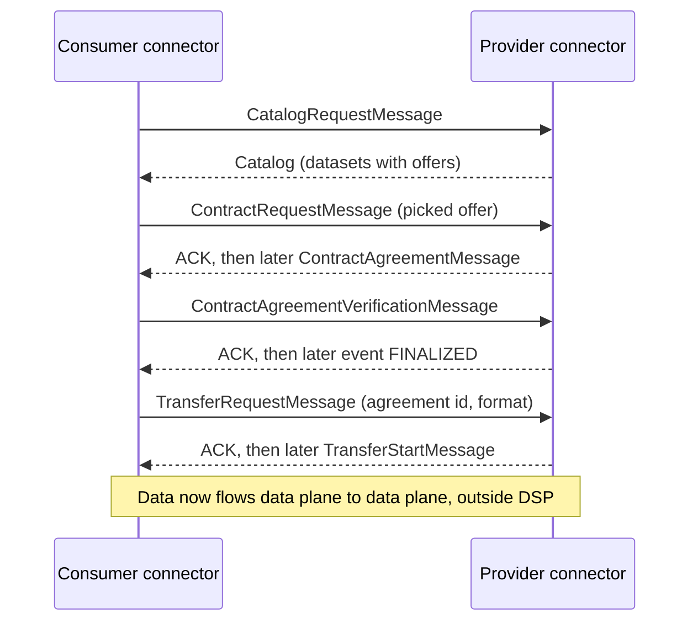
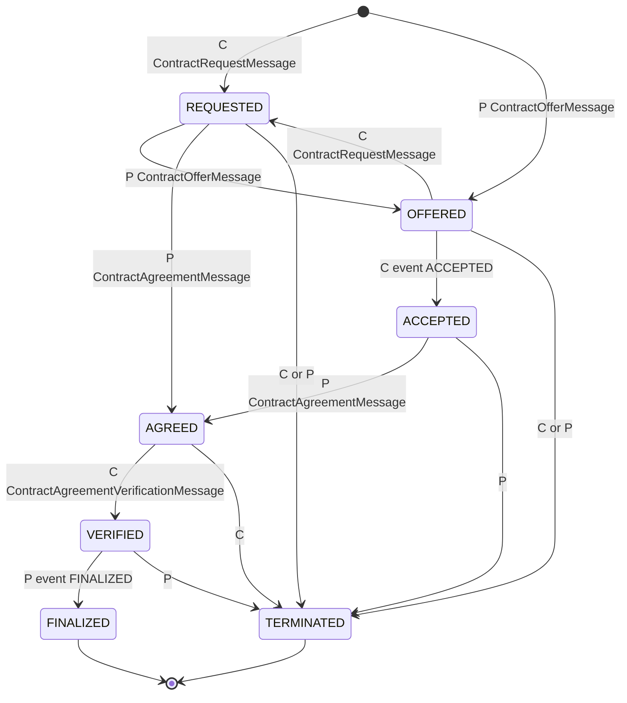
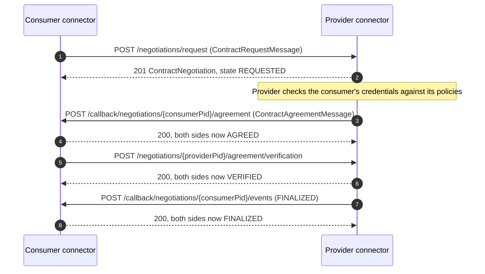
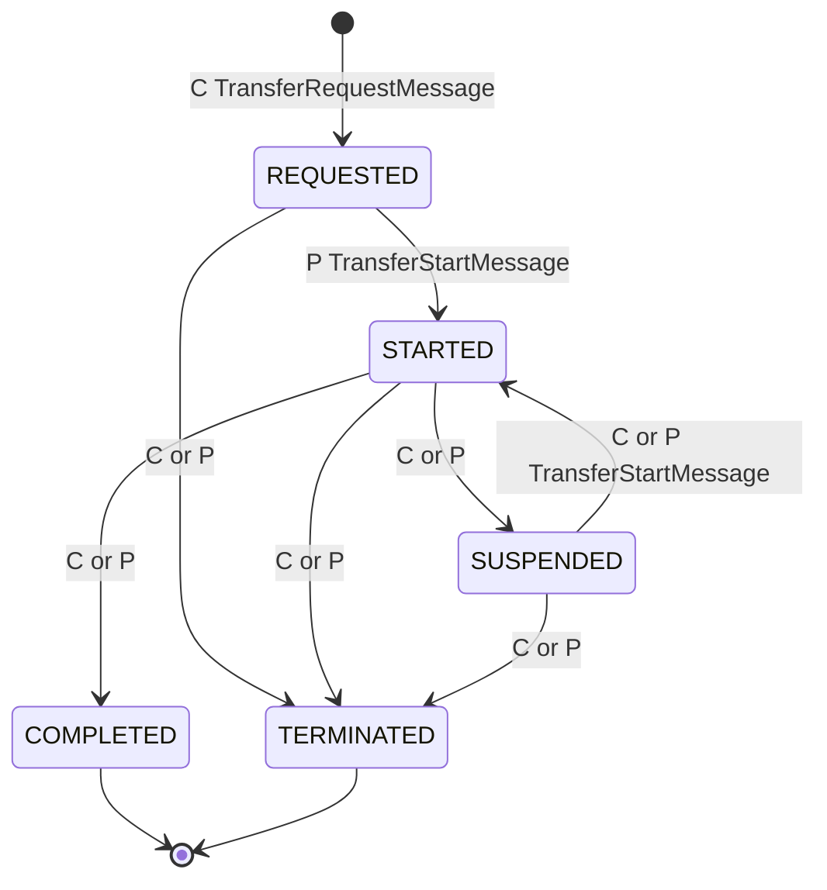

# Dataspace Protocol (DSP): Learning Guide

As of 10 October 2026 · covers DSP 2025-1, current erratum 1.0.2

## 1. How to use this guide

This guide explains the Dataspace Protocol in depth: what it defines, the terms it uses, every message and state, how the wire format works, and how EDC and Tractus-X EDC implement it. The [Backend Team Primer](Catena-X%20%26%20Tractus-X%20Backend%20Team%20Primer.md) gives a one-section overview of DSP (its section 6); read that first if you are new to Catena-X, then come here when you need to read DSP traffic, debug a negotiation or build something that speaks the protocol.

Read sections 2–4 for the big picture, version history and vocabulary. Sections 5–8 walk through the specification itself: the common rules, then the Catalog, Contract Negotiation and Transfer Process protocols. Section 9 covers JSON-LD and the policy profile, section 10 maps all of it onto EDC and Tractus-X EDC, and sections 11–13 cover conformance testing, pitfalls and further reading.

Everything in sections 5–9 is taken from the [DSP 2025-1 specification](https://eclipse-dataspace-protocol-base.github.io/DataspaceProtocol/2025-1-err2/) and its [source repository](https://github.com/eclipse-dataspace-protocol-base/DataspaceProtocol) at tag `2025-1-err2`. Statements about EDC and Tractus-X EDC were checked against the source at EDC v0.17.0 and tractusx-edc 0.13.0, the versions the other documents in this repository use.

## 2. DSP in one page

DSP is a set of message types and state machines that two **Participant Agents**, usually two connectors, exchange to share data under agreed terms. It has three protocols, each with an abstract definition and an HTTPS binding:

| Protocol | Question it answers | Result |
| --- | --- | --- |
| Catalog | What data does this provider offer me, and on what terms? | A DCAT catalog of datasets, each with one or more ODRL offers |
| Contract Negotiation | Can we agree terms for this dataset? | A signed-off ODRL agreement, identified by an agreement id |
| Transfer Process | Give me access to the data under that agreement | A running transfer: the provider pushes data, or the consumer gets an endpoint and token to pull it |

Four properties shape everything else:

- **Asynchronous.** A request is answered with an acknowledgement, not a result. The real answer arrives later as a separate message to the other side's callback address. Both sides therefore persist each negotiation and transfer as a state machine.
- **Symmetric state.** Provider and consumer each keep their own copy of the state, and a state only changes when the counter-party acknowledges a message. If the copies ever disagree, the process must be terminated.
- **Control plane only.** DSP governs *access to* data, never the data itself. The bytes move over a separate wire protocol (HTTP, S3, Kafka and so on) handled by the data plane.
- **JSON with a JSON-LD context.** Messages are JSON documents validated by JSON Schema, with a JSON-LD context so implementations can process them either as plain JSON or as linked data.

DSP deliberately leaves out:

- **Identity and trust.** Every request carries an `Authorization` header, but DSP does not say what is in it. In Catena-X that gap is filled by the Decentralized Claims Protocol (primer section 7 and the [DCP Developer Guide](decentralized-claims-protocol-guide.md)).
- **Policy vocabulary.** DSP uses ODRL's structure but defines no business terms. Each dataspace publishes its own (in Catena-X, CX-0152 and the policy context).
- **Data transfer protocols and data plane interfaces.** DSP starts and stops transfers; how data actually moves is out of scope.
- **Finding participants.** How a consumer discovers which providers exist is left to each dataspace. DSP only standardises how to find a known participant's connector and supported versions (section 5).



## 3. Versions and history

DSP began at the International Data Spaces Association (IDSA) and moved to the Eclipse Foundation, where it is now maintained by the [Eclipse Dataspace Protocol project](https://projects.eclipse.org/projects/technology.dataspace-protocol-base) under the Eclipse Dataspace Working Group ([repository README](https://github.com/eclipse-dataspace-protocol-base/DataspaceProtocol#about-versions)).

| Version | Published | Governance | Status for us |
| --- | --- | --- | --- |
| [0.8](https://github.com/International-Data-Spaces-Association/ids-specification/releases/tag/v0.8) | 11 Sep 2023 | IDSA | Still spoken by Jupiter-era Catena-X connectors; tractusx-edc keeps its own 0.8 implementation |
| [2024-1](https://github.com/International-Data-Spaces-Association/ids-specification/releases/tag/2024-1) | 19 Jun 2024 | IDSA, contributed to Eclipse | No longer supported: upstream EDC removed it in v0.16.0 and tractusx-edc in 0.12.0 |
| [2025-1](https://eclipse-dataspace-protocol-base.github.io/DataspaceProtocol/2025-1/) | Eclipse release 1.0.0 on 23 Jul 2025; spec dated 12 Aug 2025 | Eclipse | The current version, and the only one upstream EDC speaks |
| [2025-1-err1](https://eclipse-dataspace-protocol-base.github.io/DataspaceProtocol/2025-1-err1/) | Eclipse release 1.0.1, 12 Nov 2025 | Eclipse | Editorial erratum |
| [2025-1-err2](https://eclipse-dataspace-protocol-base.github.io/DataspaceProtocol/2025-1-err2/) | Eclipse release 1.0.2, 10 Sep 2026 | Eclipse | Editorial erratum; the version the spec site now redirects to |

Release numbers and dates come from the [project's governance page](https://projects.eclipse.org/projects/technology.dataspace-protocol-base/governance) and the repository tags. The two errata keep the 2025-1 version string and namespace and change no message or endpoint: they capitalise the RFC 2119 keywords, fix a sentence about distributions, and align the definitions of terms such as Dataspace and Data Sharing with the ISO/IEC 20151-1 draft. The repository's `main` branch is now marked unofficial and open for the next revision.

**Standardisation.** On 2 December 2025 the Eclipse Foundation announced that DSP and DCP will be submitted to ISO/IEC JTC 1 through the Publicly Available Specification (PAS) route ([announcement](https://newsroom.eclipse.org/node/43194)). As of 10 October 2026 we found no announcement that the PAS process has finished. Do not confuse this with **ISO/IEC 20151**, a separate standard on dataspace concepts and characteristics whose definitions DSP now quotes ([IDSA on 20151](https://internationaldataspaces.org/standardization-in-data-spaces-where-iso-iec-20151-stands-in-2026/)).

### What changed between versions

| Aspect | 0.8 | 2024-1 | 2025-1 |
| --- | --- | --- | --- |
| Process identifiers | One `processId` shared by both sides | Separate `consumerPid` and `providerPid`, each chosen by its owner | Same as 2024-1 |
| Term style in JSON | Prefixed: `dspace:processId`, `odrl:permission`, `dcat:dataset` | Still prefixed: `dspace:consumerPid`, `odrl:target` | Plain compact terms: `consumerPid`, `permission`, `dataset` |
| Namespace | `https://w3id.org/dspace/v0.8/` in implementations such as tractusx-edc (the 0.8 spec examples use a placeholder) | `https://w3id.org/dspace/2024/1/` | `https://w3id.org/dspace/2025/1/` |
| Version discovery | None | `protocolVersions` array with `version` and `path` | Adds `binding`, `serviceId`, `identifierType` and `auth`; the endpoint must be unauthenticated |
| Connector discovery via DID | None | None | `DataService` and `CatalogService` entries in the participant's DID document |
| Processing model | JSON-LD | JSON-LD | JSON Schema is normative; the `@protected` JSON-LD context compacts to schema-valid JSON, so plain JSON processing is allowed |

The move from one `processId` to two ids is the change that most affects code: each side now addresses the other's copy of the process by the other side's id (section 7).

## 4. Terminology

### 4.1 Terms the specification defines

These are the terms in the spec's "Terms and definitions" section, restated in plainer words. Where the spec quotes ISO/IEC 20151-1, the meaning is the same; only the wording is simplified.

| Term | Meaning | Where you meet it |
| --- | --- | --- |
| Dataspace | An environment for trusted data sharing between parties, based on an agreed governance framework, policies, semantic models, protocols and supporting services | Catena-X is one; DSP only covers the protocol part |
| Governance Framework | The strategies, policies, decision structures and accountabilities through which a dataspace is governed | The Catena-X operating model and rulebooks |
| Data Sharing | Access to the same data by more than one authorised party, either by granting access to the original or by giving a copy | The goal everything else serves |
| Participant | A member of one or more dataspaces that provides and/or consumes datasets, and registers participant agents to act for it | A company with a BPN and DID |
| Participant Agent | A system that acts in the dataspace on a participant's behalf, such as publishing a catalog or running a transfer. A logical role, not necessarily one process | A connector, a catalog service, a wallet |
| Connector (Data Service) | A participant agent that runs contract negotiations and transfer processes with other connectors by implementing DSP | An EDC control plane |
| Catalog Service | A participant agent that makes a catalog available to participants | Usually the same EDC control plane |
| Provider | A participant that offers a dataset | The supplier exposing a passport |
| Consumer | A participant that requests access to an offered dataset | The OEM or app reading it |
| Dataset | Data or a technical service that a participant can share | An EDC asset, such as a submodel or an API |
| Catalog | A collection of entries representing a provider's offers | The response to a catalog request |
| Policy | A set of rules, duties and obligations that define the terms of use for a dataset | ODRL policies in EDC |
| Offer | A concrete policy attached to a specific dataset | Each `hasPolicy` entry in a catalog |
| Agreement | A concrete policy for a specific dataset that provider and consumer have agreed through a contract negotiation | The contract agreement whose id a transfer needs |
| Contract Negotiation | One run of the negotiation state machine between a provider and a consumer, which may produce an agreement | An EDC `ContractNegotiation` |
| Transfer Process | One run of the transfer state machine, giving access to a dataset under an agreement | An EDC `TransferProcess` |
| Catalog Protocol, Contract Negotiation Protocol, Transfer Process Protocol | The allowed message types (and, for the last two, message sequences as a state machine) for each phase | Sections 6–8 |
| Dataspace Protocol | The full set of messages and sequences between participant agents | This document |
| Data Transfer Protocol | The network protocol that actually moves data, such as HTTP, FTP, MQTT or AMQP | Out of DSP's scope |
| Message Type | The definition of a message's structure | Each `...Message` and its JSON Schema |
| Profile | A restriction of an external specification such that everything still conforms to the original | DSP's own ODRL profile; Catena-X's policy profile on top |

### 4.2 Terms used in messages and bindings

These are not in the definitions list but appear throughout the messages, schemas and bindings.

| Term | Meaning |
| --- | --- |
| `consumerPid`, `providerPid` | Each side's own identifier for the same negotiation or transfer. The consumer picks `consumerPid`, the provider picks `providerPid`, and after the first message every message carries both |
| `callbackAddress` | The base URL where the initiating party receives the asynchronous replies. Callback paths are appended to it |
| `<root>`, `<base>` | `<root>` is where a connector serves `/.well-known/dspace-version`; `<base>` is `<root>` plus the `path` for one DSP version, and all endpoints of that version hang off it |
| Binding | The mapping of the abstract messages onto a concrete transport. 2025-1 defines only HTTPS |
| ACK, ERROR | The two response types. An ACK is the process object (or catalog) returned on success; an ERROR is an error object with `code` and `reason` and causes no state change |
| `hasPolicy` | The property that attaches offers to a dataset |
| Distribution | One way a dataset can be obtained: a `format` plus the `accessService` that serves it |
| DataService (in a catalog) | The connector endpoint (`endpointURL`) where negotiations and transfers for a distribution start |
| `format` | The transfer type of a distribution, such as `HttpData-PULL`. DSP does not define the values; profiles and implementations do |
| `participantId` | The provider's identifier at the top of a catalog. In Catena-X over 2025-1 this is the provider's DID |
| `target` | The dataset an offer or agreement refers to |
| `assigner`, `assignee` | The parties of an agreement: provider and consumer, identified in a dataspace-specific way |
| DataAddress | Transport details for a transfer: an `endpointType`, an optional `endpoint` and a list of `endpointProperties` |
| `authorization`, `authType` | Optional endpoint properties carrying a token and its type (for example `bearer`) |
| Push, pull | Who starts moving data: in push the provider's data plane sends to the consumer; in pull the consumer's side fetches from the provider |
| Finite, non-finite | Whether the data has an end (a file) or not (a stream or an API). Non-finite transfers run until someone terminates them |
| Control plane, data plane | The coordinating layer that speaks DSP, and the layer that moves data. DSP only specifies the former |
| Version metadata endpoint | `/.well-known/dspace-version`, which lists the DSP versions and paths a connector supports |
| Catalog Broker | A consumer that reads several upstream catalog services and re-publishes them as one, honouring upstream access rules |
| Proof Metadata Endpoint | An endpoint a binding should define so clients can learn which proofs a catalog request may need |
| TCK | Technology Compatibility Kit, the official conformance test suite (section 11) |

### 4.3 EDC and Tractus-X vocabulary mapped to DSP

EDC uses its own names for many DSP concepts. The mapping below saves a lot of confusion when reading code, logs or the Management API.

| EDC or Tractus-X term | DSP equivalent | Note |
| --- | --- | --- |
| Asset | Dataset | The asset id becomes the dataset `@id` in the catalog |
| Contract definition | (none) | Internal: binds assets to an access policy and a contract policy. EDC generates one offer per matching asset |
| Access policy | (none) | Decides whether a dataset appears in a requester's catalog at all. Never sent over DSP |
| Contract policy | Offer, then Agreement | Becomes the offer in the catalog and, once agreed, the agreement's rules |
| Management API | (none) | Your own apps → your own connector. Not part of DSP |
| Protocol API, DSP API | DSP HTTPS binding | Connector ↔ connector, internet-facing |
| `counterPartyAddress` | `<base>` of the other connector | Includes the version path, e.g. `.../api/v1/dsp/2025-1` |
| `counterPartyId` | The other participant's identifier | A DID over 2025-1, a BPN over 0.8 in Catena-X |
| `protocol` | DSP version and binding | `dataspace-protocol-http:2025-1` or `dataspace-protocol-http` (0.8) |
| Transfer type | `format` | e.g. `HttpData-PULL`, `AmazonS3-PUSH` |
| EDR (Endpoint Data Reference) | The `dataAddress` in a TransferStartMessage | Tractus-X caches it and refreshes its token |
| `-ING` states (`REQUESTING`, `AGREEING`, ...) | (none) | EDC-internal: a decision is made but the counter-party has not acknowledged yet (section 10) |

## 5. Common rules for all three protocols

### Authorization

All requests SHOULD carry an `Authorization` header, whose content DSP does not define. It may be omitted only if the receiving connector does not require authorization. In Catena-X the header holds a DCP self-issued ID token, and the receiver uses it to fetch and verify the caller's credentials before it evaluates any policy (DCP guide sections 6, 7 and 13).

### Schemas, contexts and media type

Every message is normatively defined by a JSON Schema. The spec also publishes a JSON-LD 1.1 context, `https://w3id.org/dspace/2025/1/context.jsonld`, designed so that compacting a message with it yields JSON that validates against the schema. Implementations may therefore treat messages as plain JSON or as JSON-LD and still interoperate. The context is `@protected`, so a profile cannot silently redefine DSP terms; profile authors are advised to protect their own terms too. All requests and responses use `application/json`; `application/ld+json` may be offered in addition.

### Version metadata endpoint

Every connector MUST serve a version metadata endpoint whose path ends in `/.well-known/dspace-version`, ideally at the root per RFC 8615. The endpoint MUST be unversioned and unauthenticated, and returns at least one entry:

```json
{
  "protocolVersions": [
    {
      "version": "2025-1",
      "path": "/different/path/2025-1",
      "binding": "HTTPS",
      "auth": { "protocol": "DCP", "version": "1.0", "profile": ["vc11-sl2021/jwt"] },
      "serviceId": "service-qwerty",
      "identifierType": "did:web"
    }
  ]
}
```

| Field | Required | Meaning |
| --- | --- | --- |
| `version` | Yes | The DSP version, e.g. `2025-1` or `0.8` |
| `path` | Yes | For HTTPS, an absolute URL path appended to `<root>` to give `<base>` for this version |
| `binding` | Yes | `HTTPS`, the only binding defined |
| `serviceId` | No | Groups the endpoints that belong to one data service across versions |
| `identifierType` | No | How participants are identified in this version's messages, e.g. `did:web` |
| `auth` | No | How the endpoint is secured: `protocol` and `version` (both required inside `auth`) and an optional `profile` list |

The example is adapted from the spec's own; `identifierType` and `auth` appear on different entries there. The caller picks one entry it supports. If none matches, it MUST stop the communication.

### Finding a connector through a DID document

A participant MAY advertise its connectors in its DID document by adding `service` entries of type `DataService` (pointing to the version metadata endpoint) or `CatalogService` (pointing to a catalog endpoint):

```json
{
  "@context": ["https://w3id.org/dspace/2025/1/context.jsonld", "https://www.w3.org/ns/did/v1"],
  "id": "some:id",
  "type": "DataService",
  "serviceEndpoint": "https://bar.example.com/some/path/.well-known/dspace-version"
}
```

This is how Tractus-X EDC 0.13 finds a partner's connector from nothing but its DID (section 10).

### Errors and HTTP status codes

The bindings use the same status codes in all three protocols:

| Situation | Status | Body |
| --- | --- | --- |
| Process created (first negotiation or transfer request) | 201 Created | The process object (`ContractNegotiation` or `TransferProcess`) |
| Message accepted and state changed | 200 OK | Not specified |
| Catalog or dataset returned | 200 OK | `Catalog` or `Dataset` |
| Message would cause an invalid state transition | 400 Bad Request | Error object |
| Catalog filter not supported | 400 Bad Request | `CatalogError` |
| Process does not exist | 404 Not Found | — |
| Caller not authorized | 404 Not Found | — |

Returning 404 for unauthorized callers hides whether a process exists. EDC does not follow this and returns 401 (section 10).

## 6. Catalog Protocol

### Messages and endpoints

| Message | Sent by | HTTPS binding | Success response |
| --- | --- | --- | --- |
| CatalogRequestMessage | Consumer | `POST <base>/catalog/request` | 200 with a `Catalog` |
| DatasetRequestMessage | Consumer | `GET <base>/catalog/datasets/:id` | 200 with a `Dataset` |
| CatalogError | Provider | Response body on failure | — |

A catalog request has an optional `filter` whose content is implementation-specific; a provider that does not support the filter MUST answer 400. The dataset request names one dataset id. Both may require an authorization token.

```json
{
  "@context": ["https://w3id.org/dspace/2025/1/context.jsonld"],
  "@type": "CatalogRequestMessage",
  "filter": []
}
```

### The catalog structure

DSP reuses DCAT 3 for catalogs and ODRL for policies, restricted by its own profile.

```json
{
  "@context": ["https://w3id.org/dspace/2025/1/context.jsonld"],
  "@id": "urn:uuid:3afeadd8-ed2d-569e-d634-8394a8836d57",
  "@type": "Catalog",
  "participantId": "urn:example:DataProviderA",
  "service": [
    {
      "@id": "urn:uuid:4aa2dcc8-4d2d-569e-d634-8394a8834d77",
      "@type": "DataService",
      "endpointURL": "https://provider-a.com/connector"
    }
  ],
  "dataset": [
    {
      "@id": "urn:uuid:3dd1add8-4d2d-569e-d634-8394a8836a88",
      "@type": "Dataset",
      "hasPolicy": [
        {
          "@id": "urn:uuid:3dd1add8-4d2d-569e-d634-8394a8836a88",
          "@type": "Offer",
          "permission": [
            {
              "action": "use",
              "constraint": [
                { "leftOperand": "spatial", "operator": "eq", "rightOperand": "http://example.org/EU" }
              ]
            }
          ]
        }
      ],
      "distribution": [
        {
          "@type": "Distribution",
          "format": "HttpData-PULL",
          "accessService": "urn:uuid:4aa2dcc8-4d2d-569e-d634-8394a8834d77"
        }
      ]
    }
  ]
}
```

The rules that matter when you produce or parse a catalog:

- The top-level catalog MUST have a `participantId` and one or more `service` entries (DataServices) pointing to connectors where the datasets can be obtained.
- A catalog may have **zero** datasets. Catalogs are often generated per requester from their credentials, so an empty catalog is a valid answer, not an error.
- Each dataset MUST have at least one offer in `hasPolicy` and at least one `distribution`.
- Each distribution MUST name a `format` and an `accessService`, either as a reference to a DataService id or as an inline DataService.
- A DataService's `endpointURL` is the base the negotiation endpoints extend, and it MUST belong to the same DSP version the catalog was served through.
- Each offer MUST have a unique `@id` and is unique to its dataset. Inside a catalog or dataset an offer MUST NOT carry a `target`, because the target is implied by the enclosing dataset.
- Catalogs can nest: a catalog may contain `catalog` entries, each with its own services, which is how one provider exposes sub-catalogs.
- Providers MAY include properties the schema does not define, and consumers should tolerate them. EDC, for example, adds `endpointDescription`.

### Pagination, compression and scale

- A provider MAY paginate catalog responses. Pagination uses the HTTP `Link` header with `next` and `previous` relations; the query parameters inside the links are up to the provider.
- A provider MAY gzip responses (`Content-Encoding: gzip`).
- There is no replication protocol. Each consumer fetches catalogs from the providers it cares about, caches them, and runs queries locally. Querying across providers is the consumer's job.
- A dataspace MAY run **catalog brokers** that aggregate several providers' catalogs into one, honouring each provider's access rules.

### Access control on catalogs

Catalog services SHOULD implement access control. A provider with protected datasets has two options: list everything and enforce access only during negotiation, or require proofs with the catalog request and filter the datasets. For the second option, bindings SHOULD offer a proof metadata endpoint that tells clients which proofs to present. EDC uses the second option: the access policy of each contract definition is evaluated against the caller's verified credentials, and datasets that fail it are simply left out.

## 7. Contract Negotiation Protocol

### How a negotiation works

A negotiation involves a provider and a consumer, and both track its state. Each negotiation gets a fresh IRI that MUST NOT be reused once it reaches a terminal state. The state changes only when a message is **acknowledged** by the counter-party, so both sides always move in step; if their states ever differ, the negotiation MUST be terminated and a new one may be started.

The side that starts the negotiation sends no id for the other side. The receiver creates its own copy, picks its own process id, and returns it in the 201 response. From then on, every message carries both `consumerPid` and `providerPid`, and each side addresses the other through the other's id: the consumer calls `/negotiations/:providerPid/...`, and the provider calls back `<callbackAddress>/negotiations/:consumerPid/...`.

### Negotiation states

| State | Meaning |
| --- | --- |
| REQUESTED | The consumer has requested an agreement based on an offer, and the provider acknowledged |
| OFFERED | The provider has sent an offer (a first offer or a counter-offer), and the consumer acknowledged |
| ACCEPTED | The consumer has accepted the provider's latest offer, and the provider acknowledged |
| AGREED | The provider has accepted the latest offer and sent an agreement, and the consumer acknowledged |
| VERIFIED | The consumer has sent its verification of the agreement, and the provider acknowledged |
| FINALIZED | The provider has sent finalization, including its own verification, and the consumer acknowledged. The data is now available to the consumer. Terminal |
| TERMINATED | Either side has terminated the negotiation and the other acknowledged. Terminal |

### Negotiation state machine

C marks a message sent by the consumer, P one sent by the provider. Transitions are taken from the spec's state machine diagram.



Read it as three paths:

- **Consumer-initiated, no haggling** (what EDC does): REQUESTED → AGREED → VERIFIED → FINALIZED.
- **With counter-offers**: REQUESTED ↔ OFFERED can repeat, each side proposing new terms, until the consumer accepts (ACCEPTED) and the provider agrees (AGREED).
- **Provider-initiated**: the provider opens with an offer (OFFERED) sent to the consumer's `/negotiations/offers` endpoint.

### Negotiation messages

| Message | Sent by | Moves to | Required fields | Rules worth knowing |
| --- | --- | --- | --- | --- |
| ContractRequestMessage | Consumer | REQUESTED | `consumerPid`, `offer` (with `@id`) | Without `providerPid` it starts a new negotiation; with it, it is a counter-request. The offer MUST have a `target`, its rules MUST NOT. An unknown `offer.@id` MUST be rejected. `callbackAddress` tells the provider where to reply |
| ContractOfferMessage | Provider | OFFERED | `providerPid`, `offer` | Without `consumerPid` it starts a provider-initiated negotiation and MUST carry a `callbackAddress`. Same `target` rule as above |
| ContractAgreementMessage | Provider | AGREED | `providerPid`, `consumerPid`, `agreement` | The agreement MUST have `@id`, `target`, `timestamp` (XSD dateTime), `assigner` and `assignee`; its rules MUST NOT have a `target` |
| ContractAgreementVerificationMessage | Consumer | VERIFIED | `providerPid`, `consumerPid` | The provider MUST answer with an error if the agreement cannot be validated |
| ContractNegotiationEventMessage | Consumer (`ACCEPTED`) or provider (`FINALIZED`) | ACCEPTED or FINALIZED | `providerPid`, `consumerPid`, `eventType` | A consumer sending `FINALIZED` or a provider sending `ACCEPTED` is an error. No events may be sent after a terminal state |
| ContractNegotiationTerminationMessage | Either | TERMINATED | `providerPid`, `consumerPid` | May be sent in any non-terminal state, optionally with `code` and `reason`. Errors in reply to it may be ignored |
| ContractNegotiation (ACK) | Either | — | `providerPid`, `consumerPid`, `state` | Returned on success and by the GET endpoints |
| ContractNegotiationError | Either | — | `providerPid`, `consumerPid` | Optional `code` and `reason`; causes no state change |

The initial request from a consumer:

```json
{
  "@context": ["https://w3id.org/dspace/2025/1/context.jsonld"],
  "@type": "ContractRequestMessage",
  "consumerPid": "urn:uuid:32541fe6-c580-409e-85a8-8a9a32fbe833",
  "offer": {
    "@type": "Offer",
    "@id": "urn:uuid:2828282:3dd1add8-4d2d-569e-d634-8394a8836a89",
    "target": "urn:uuid:3dd1add8-4d2d-569e-d634-8394a8836a88",
    "permission": [{ "action": "use" }]
  },
  "callbackAddress": "https://example.com/callback"
}
```

The agreement the provider sends back:

```json
{
  "@context": ["https://w3id.org/dspace/2025/1/context.jsonld"],
  "@type": "ContractAgreementMessage",
  "providerPid": "urn:uuid:a343fcbf-99fc-4ce8-8e9b-148c97605aab",
  "consumerPid": "urn:uuid:32541fe6-c580-409e-85a8-8a9a32fbe833",
  "agreement": {
    "@id": "urn:uuid:e8dc8655-44c2-46ef-b701-4cffdc2faa44",
    "@type": "Agreement",
    "target": "urn:uuid:3dd1add4-4d2d-569e-d634-8394a8836d23",
    "timestamp": "2023-01-01T01:00:00Z",
    "assigner": "http://example.com/Provider",
    "assignee": "http://example.com/Consumer",
    "permission": [
      {
        "action": "use",
        "constraint": [{ "leftOperand": "dateTime", "operator": "lteq", "rightOperand": "2023-12-31T06:00Z" }]
      }
    ]
  }
}
```

The agreement's `@id` is what the consumer later passes as `agreementId` in a transfer request.

### Negotiation HTTPS endpoints

Provider side, relative to the provider's `<base>`:

| Method and path | Message | Response |
| --- | --- | --- |
| `GET /negotiations/:providerPid` | (read state) | 200 with `ContractNegotiation` |
| `POST /negotiations/request` | Initial ContractRequestMessage | 201 with `ContractNegotiation` |
| `POST /negotiations/:providerPid/request` | Counter ContractRequestMessage | 200 |
| `POST /negotiations/:providerPid/events` | Event `ACCEPTED` | 200; 400 if the current offer came from the consumer |
| `POST /negotiations/:providerPid/agreement/verification` | ContractAgreementVerificationMessage | 200 |
| `POST /negotiations/:providerPid/termination` | ContractNegotiationTerminationMessage | 200 |

Consumer side, relative to the consumer's `callbackAddress` (shown as `/:callback`), except the initial offer:

| Method and path | Message | Response |
| --- | --- | --- |
| `GET /:callback/negotiations/:consumerPid` | (read state) | 200 with `ContractNegotiation` |
| `POST /negotiations/offers` | Initial ContractOfferMessage (provider-initiated) | 201 with `ContractNegotiation` |
| `POST /:callback/negotiations/:consumerPid/offers` | Counter ContractOfferMessage | 200 |
| `POST /:callback/negotiations/:consumerPid/agreement` | ContractAgreementMessage | 200 |
| `POST /:callback/negotiations/:consumerPid/events` | Event `FINALIZED` | 200 |
| `POST /:callback/negotiations/:consumerPid/termination` | ContractNegotiationTerminationMessage | 200 |

The callback base MUST support HTTPS, and receivers SHOULD cope with a `callbackAddress` that does or does not end in `/`. If a receiver does not understand a callback address, it MUST return an unrecoverable error.

### The happy path on the wire

This is the sequence two EDC connectors produce for one negotiation. Every arrow is a separate HTTP request answered immediately; the "later" arrows are new requests in the opposite direction.



## 8. Transfer Process Protocol

### Concepts

A transfer process gives the consumer access to a dataset under an existing agreement. Its messages are handled by each side's **control plane**, while the data itself moves between **data planes** over a wire protocol that DSP does not specify.

- **Push**: the provider's data plane sends the data to an endpoint the consumer named in its transfer request.
- **Pull**: the provider answers the transfer request with an endpoint (and usually a token) in its start message, and the consumer's side fetches the data. This is the normal Catena-X pattern.
- **Finite or non-finite**: finite data (a file, a dataset) completes when sent; non-finite data (a stream, an API) keeps the transfer open until one side terminates it.

### Transfer states

| State | Meaning |
| --- | --- |
| REQUESTED | The consumer has requested a dataset under an agreement, and the provider acknowledged |
| STARTED | The data is available to the consumer (pull), or the provider has started pushing it |
| SUSPENDED | Either side has paused the transfer; it can be started again |
| COMPLETED | Either side has completed the transfer. Terminal |
| TERMINATED | Either side has terminated the transfer. Terminal |

### Transfer state machine



Only the provider can make the first move to STARTED. After a suspension either side can resume by sending a TransferStartMessage, which is why the provider exposes a `/start` endpoint too.

### Transfer messages

| Message | Sent by | Moves to | Required fields | Rules worth knowing |
| --- | --- | --- | --- | --- |
| TransferRequestMessage | Consumer | REQUESTED | `consumerPid`, `agreementId`, `format`, `callbackAddress` | `format` comes from a distribution in the catalog. `dataAddress` is included only when the format needs a push destination. Providers SHOULD be idempotent on `consumerPid`: a repeated request should get the same start message again, not a second transfer |
| TransferStartMessage | Provider (and either side when resuming) | STARTED | `providerPid`, `consumerPid` | For a pull transfer the provider MUST include a `dataAddress`; its `endpointType` decides which `endpointProperties` are required, as defined in a profile outside DSP |
| TransferSuspensionMessage | Either | SUSPENDED | `providerPid`, `consumerPid` | Optional `code` and `reason` |
| TransferCompletionMessage | Either | COMPLETED | `providerPid`, `consumerPid` | May be skipped when the wire protocol already signals completion |
| TransferTerminationMessage | Either | TERMINATED | `providerPid`, `consumerPid` | Allowed in any non-terminal state; may carry error details |
| TransferProcess (ACK) | Either | — | `providerPid`, `consumerPid`, `state` | Returned on success and by the GET endpoint |
| TransferError | Either | — | `providerPid`, `consumerPid` | Optional `code` and `reason`; causes no state change |

A push request names the destination in `dataAddress`:

```json
{
  "@context": ["https://w3id.org/dspace/2025/1/context.jsonld"],
  "@type": "TransferRequestMessage",
  "consumerPid": "urn:uuid:32541fe6-c580-409e-85a8-8a9a32fbe833",
  "agreementId": "urn:uuid:e8dc8655-44c2-46ef-b701-4cffdc2faa44",
  "format": "example:HTTP_PUSH",
  "dataAddress": {
    "@type": "DataAddress",
    "endpointType": "https://w3id.org/idsa/v4.1/HTTP",
    "endpoint": "http://example.com",
    "endpointProperties": [
      { "@type": "EndpointProperty", "name": "authorization", "value": "TOKEN-ABCDEFG" },
      { "@type": "EndpointProperty", "name": "authType", "value": "bearer" }
    ]
  },
  "callbackAddress": "https://example.com/callback"
}
```

For a pull, the request has no `dataAddress`. Instead the provider's TransferStartMessage carries one with the same shape, pointing at the provider's data plane, and the `authorization` property holds the short-lived token the consumer must present. In EDC this data address is the **EDR**.

### Transfer HTTPS endpoints

Provider side, relative to `<base>`:

| Method and path | Message | Response |
| --- | --- | --- |
| `GET /transfers/:providerPid` | (read state) | 200 with `TransferProcess` |
| `POST /transfers/request` | TransferRequestMessage | 201 with `TransferProcess` |
| `POST /transfers/:providerPid/start` | TransferStartMessage (consumer resuming after suspension) | 200 |
| `POST /transfers/:providerPid/completion` | TransferCompletionMessage | 200 |
| `POST /transfers/:providerPid/termination` | TransferTerminationMessage | 200 |
| `POST /transfers/:providerPid/suspension` | TransferSuspensionMessage | 200 |

Consumer side, relative to the consumer's `callbackAddress`:

| Method and path | Message | Response |
| --- | --- | --- |
| `POST /:callback/transfers/:consumerPid/start` | TransferStartMessage | 200 |
| `POST /:callback/transfers/:consumerPid/completion` | TransferCompletionMessage | 200 |
| `POST /:callback/transfers/:consumerPid/termination` | TransferTerminationMessage | 200 |
| `POST /:callback/transfers/:consumerPid/suspension` | TransferSuspensionMessage | 200 |

Unlike negotiations, the consumer side has no GET endpoint for transfers in 2025-1.

## 9. The wire format: JSON-LD and the ODRL profile

### Namespaces and contexts

| Prefix | IRI | Used for |
| --- | --- | --- |
| `dspace` | `https://w3id.org/dspace/2025/1/` | DSP message types and properties |
| `odrl` | `http://www.w3.org/ns/odrl/2/` | Policies, offers, agreements, rules, constraints |
| `dcat` | `http://www.w3.org/ns/dcat#` | Catalog, Dataset, Distribution, DataService |
| `dct` | `http://purl.org/dc/terms/` | Metadata such as `format` |
| `xsd` | `http://www.w3.org/2001/XMLSchema#` | Data types such as `dateTime` |

Messages reference `https://w3id.org/dspace/2025/1/context.jsonld`, which maps the short terms (`consumerPid`, `permission`, `dataset`) to these IRIs and imports the ODRL profile context `https://w3id.org/dspace/2025/1/odrl-profile.jsonld` where policies appear. The schemas are published under `https://w3id.org/dspace/2025/1/<protocol>/<name>-schema.json`.

Three practical consequences:

- **Plain JSON works, if you stay compacted.** A client that sends exactly the documented shape and reads responses by the documented keys can skip JSON-LD processing entirely. That only holds while the other side also emits the canonical compacted form.
- **Real implementations add contexts.** EDC compacts its responses with additional contexts and may render a one-item array as a single object. The Tractus-X catalog response, for instance, lists the Tractus-X auth, Catena-X policy, DSP and EDC contexts and returns `dataset` and `hasPolicy` as objects when there is only one ([walkthrough](https://github.com/eclipse-tractusx/tractusx-edc/blob/0.13.0/docs/usage/management-api-walkthrough/04_catalog.md)). Code that reads EDC output should use a JSON-LD library or accept both forms (primer section 16).
- **Profiles add terms on top.** Catena-X policies need the Catena-X policy context so that terms such as `FrameworkAgreement` and `UsagePurpose` resolve. Because DSP's context is protected, a profile can add terms but cannot redefine DSP's.

### The ODRL profile

DSP restricts ODRL to a smaller, predictable subset, enforced by the JSON Schemas:

- **Policy types**: `Offer` (in catalogs, without `target`), an offer inside a message (with `target`), and `Agreement` (with `target`, `assigner`, `assignee` and `timestamp`). Every policy needs an `@id`; an offer needs at least one `permission` or `prohibition`.
- **Rules**: `permission`, `prohibition` and `obligation` (duty), each with an `action` and optional `constraint` list.
- **Atomic constraints**: `leftOperand`, `operator`, `rightOperand`, all required. The right operand may be a string, an object or an array.
- **Operators allowed**: `eq`, `neq`, `gt`, `gteq`, `lt`, `lteq`, `hasPart`, `isA`, `isAllOf`, `isAnyOf`, `isNoneOf`, `isPartOf`, `term-lteq`.
- **Logical constraints**: `and`, `or`, `xone` (exactly one) and `andSequence` (all, in order), each holding a list of constraints. They can be nested.
- **Actions and left operands**: plain strings. DSP defines none; the dataspace's profile does, e.g. `use` and `access` with `FrameworkAgreement` or `Membership` in Catena-X (primer section 11).

## 10. DSP in EDC and Tractus-X EDC

### Two APIs, two audiences

An EDC control plane exposes several HTTP APIs. Two of them matter here, and they must never be confused:

| | Management API | Protocol (DSP) API |
| --- | --- | --- |
| Who calls it | Your own backends and tools | Other participants' connectors |
| Standard | EDC-specific (v3, v4) | DSP |
| Exposure | Internal only, protected by an API key | Internet-facing, protected by DCP |
| Path | Set by `web.http.management.path` | `/api/protocol` by default in upstream EDC ([source](https://github.com/eclipse-edc/Connector/blob/v0.17.0/data-protocols/dsp/dsp-core/dsp-http-api-base-configuration/src/main/java/org/eclipse/edc/protocol/dsp/http/api/configuration/DspApiBaseConfigurationExtension.java)); `/api/v1/dsp` in the Tractus-X Helm chart ([values](https://github.com/eclipse-tractusx/tractusx-edc/blob/0.13.0/charts/tractusx-connector/values.yaml)) |

You never write DSP messages by hand when using EDC. You call the Management API on your own connector, and it sends the DSP messages for you:

| Management API call (v3) | DSP message(s) it triggers |
| --- | --- |
| `POST /v3/catalog/request` | CatalogRequestMessage |
| `POST /v3/catalog/dataset/request` | DatasetRequestMessage |
| `POST /v3/contractnegotiations` | ContractRequestMessage, then the rest of the negotiation runs automatically |
| `POST /v3/contractnegotiations/{id}/terminate` | ContractNegotiationTerminationMessage |
| `POST /v3/transferprocesses` | TransferRequestMessage |
| `POST /v3/transferprocesses/{id}/suspend`, `/resume`, `/terminate` | TransferSuspensionMessage, TransferStartMessage, TransferTerminationMessage |

Endpoints from the EDC v0.17.0 Management API controllers. In v4 the paths start with `/v4` instead.

### Versions, paths and identifiers in a Tractus-X deployment

Tractus-X EDC 0.13.0 serves two DSP versions side by side under the protocol path:

| DSP version | `protocol` value | `counterPartyAddress` | `counterPartyId` |
| --- | --- | --- | --- |
| 2025-1 | `dataspace-protocol-http:2025-1` | `https://<host>/api/v1/dsp/2025-1` | The partner's DID |
| 0.8 | `dataspace-protocol-http` | `https://<host>/api/v1/dsp` | The partner's BPNL |

The version metadata endpoint is mounted on the protocol context, so it is reachable at `https://<host>/api/v1/dsp/.well-known/dspace-version`. Upstream EDC dropped all versions except 2025-1 in v0.16.0; the 0.8 binding is Tractus-X's own code (comparison guide section 7.5).

Tractus-X adds a **connector discovery** API that automates section 5 for you ([walkthrough](https://github.com/eclipse-tractusx/tractusx-edc/blob/0.13.0/docs/usage/management-api-walkthrough/04_catalog.md)):

- `POST /v3/connectordiscovery/connectors` takes a partner DID, downloads its DID document, follows each `DataService` entry to the version metadata endpoint, and returns the `counterPartyAddress` and `protocol` to use for each connector found.
- `POST /v3/connectordiscovery/dspversionparams` does the same for a connector whose address you already know.

Both pick the newest DSP version that the two connectors share. To be found this way, a connector must have a `DataService` entry in its own DID document. Tractus-X EDC can register one itself when `tx.edc.did.service.self.registration.enabled` is set; it defaults to `false` ([source](https://github.com/eclipse-tractusx/tractusx-edc/blob/0.13.0/edc-extensions/did-document/did-document-service-self-registration/src/main/java/org/eclipse/tractusx/edc/did/document/service/self/registration/DidDocumentServiceSelfRegistrationExtension.java)).

### How EDC behaves within the protocol

- **No counter-offers.** An EDC provider moves a requested negotiation straight to agreeing, so you will see REQUESTED → AGREED and never OFFERED or ACCEPTED in EDC-to-EDC traffic. The provider resolves the offer `@id` to its own contract definition and builds the agreement from its own contract policy, ignoring any changes the consumer made to the rules. The consumer's connector then compares the agreement with the offer it sent and terminates if they differ ([source](https://github.com/eclipse-edc/Connector/blob/v0.17.0/core/control-plane/control-plane-contract/src/main/java/org/eclipse/edc/connector/controlplane/contract/validation/ContractValidationServiceImpl.java)). In practice: request the offer exactly as the catalog returned it.
- **Automatic verification.** An EDC consumer verifies an agreement as soon as it arrives, and the provider then finalizes it. A negotiation started through the Management API either reaches FINALIZED or TERMINATED without further calls.
- **Offer ids carry meaning.** EDC builds an offer `@id` from three base64-encoded parts separated by colons: the contract definition id, the asset id and a random UUID ([source](https://github.com/eclipse-edc/Connector/blob/v0.17.0/spi/control-plane/contract-spi/src/main/java/org/eclipse/edc/connector/controlplane/contract/spi/ContractOfferId.java)). Decoding one tells you which contract definition produced the offer.
- **401, not 404.** When the caller's token or credentials fail, EDC answers 401 Unauthorized, not the 404 the binding prescribes. It also uses 409 Conflict, and 400 for other failures ([source](https://github.com/eclipse-edc/Connector/blob/v0.17.0/data-protocols/dsp/dsp-core/dsp-http-core/src/main/java/org/eclipse/edc/protocol/dsp/http/message/DspRequestHandlerImpl.java)).

### EDC's internal states are not DSP states

EDC stores more states than DSP defines. The extra ones mark work in progress: EDC has decided to send a message but the counter-party has not acknowledged it yet. The Management API shows these internal states, so a negotiation reported as `AGREEING` is not yet AGREED in DSP terms.

| EDC negotiation states ([source](https://github.com/eclipse-edc/Connector/blob/v0.17.0/spi/control-plane/contract-spi/src/main/java/org/eclipse/edc/connector/controlplane/contract/spi/types/negotiation/ContractNegotiationStates.java)) | DSP state |
| --- | --- |
| `INITIAL`, `REQUESTING` | (not yet sent) |
| `REQUESTED` | REQUESTED |
| `OFFERING`, `OFFERED` | OFFERED once acknowledged |
| `ACCEPTING`, `ACCEPTED` | ACCEPTED once acknowledged |
| `AGREEING`, `AGREED` | AGREED once acknowledged |
| `VERIFYING`, `VERIFIED` | VERIFIED once acknowledged |
| `FINALIZING`, `FINALIZED` | FINALIZED once acknowledged |
| `TERMINATING`, `TERMINATED` | TERMINATED once acknowledged |

Transfers have even more internal states, because EDC also provisions resources and talks to its data plane ([source](https://github.com/eclipse-edc/Connector/blob/v0.17.0/spi/control-plane/transfer-spi/src/main/java/org/eclipse/edc/connector/controlplane/transfer/spi/types/TransferProcessStates.java)): `INITIAL`, `PROVISIONING`, `PREPARATION_REQUESTED`, `PROVISIONED`, `REQUESTING`, `REQUESTED`, `STARTING`, `STARTUP_REQUESTED`, `STARTED`, `SUSPENDING`, `SUSPENDING_REQUESTED`, `SUSPENDED`, `RESUMING`, `RESUMED`, `COMPLETING`, `COMPLETING_REQUESTED`, `COMPLETED`, `TERMINATING`, `TERMINATING_REQUESTED`, `TERMINATED`, `DEPROVISIONING`, `DEPROVISIONING_REQUESTED`, `DEPROVISIONED`. Only `REQUESTED`, `STARTED`, `SUSPENDED`, `COMPLETED` and `TERMINATED` exist in DSP; the rest are local bookkeeping, and `DEPROVISIONED` can follow a DSP-terminal state.

## 11. Conformance: the DSP TCK

The [DSP Technology Compatibility Kit](https://github.com/eclipse-dataspacetck/dsp-tck) is the official test suite for checking that a connector implements DSP correctly. It runs scripted catalog, negotiation and transfer scenarios against a connector under test, including error and termination paths. Its first final release, 1.0.0, came out on 12 June 2026; the latest is v1.0.2 from 4 September 2026 ([releases](https://github.com/eclipse-dataspacetck/dsp-tck/releases)).

tractusx-edc runs both the DSP and DCP TCKs in CI (primer section 14), and upstream publishes which protocol versions EDC passes on its [compatibility page](https://eclipse-edc.github.io/documentation/compatibility/). If we ever build a DSP endpoint outside EDC, for example a lightweight catalog service, the TCK is the way to prove it interoperates.

## 12. Pitfalls

1. **Wrong address for the version.** Over 2025-1 the `counterPartyAddress` ends in `/2025-1`; over 0.8 it is the bare protocol path. Mixing them gives 404s or JSON that fails to parse. Use connector discovery instead of hard-coding.
2. **Wrong kind of partner id.** `counterPartyId` is a DID over 2025-1 and a BPNL over 0.8 in Catena-X. A mismatch fails the identity check, which shows up as 401 from EDC or an empty catalog.
3. **Reading an empty catalog as an error.** An empty catalog is a valid DSP answer: the provider filtered out everything your credentials do not satisfy. Check DCP scopes and credentials, not the network (primer section 18).
4. **Editing the offer.** Request the offer exactly as the catalog returned it, `@id` and rules included. An EDC provider does not counter-offer: it agrees on its own policy, and your connector then terminates because the agreement does not match what it asked for.
5. **Treating the ACK as the result.** A 201 on `/negotiations/request` only means the provider created its copy. Wait for FINALIZED (or TERMINATED) through polling or EDC callbacks before starting a transfer (primer section 16).
6. **Unreachable callback address.** The provider sends agreements and start messages to the consumer's `callbackAddress`. If the consumer's DSP endpoint is not reachable from the internet, the consumer's negotiations never get past REQUESTED.
7. **Parsing EDC output as fixed JSON.** Extra contexts, different prefixes and single objects instead of one-item arrays are all legal. Read by IRI or through a JSON-LD library.
8. **Confusing EDC states with DSP states.** `AGREEING` or `STARTING` in the Management API means a message is still on its way, not that the protocol state has changed.
9. **Expecting 404 for auth failures.** The spec says 404; EDC returns 401. Write clients that handle both.

## 13. Further reading

| # | Read | Focus on |
| --- | --- | --- |
| 1 | [DSP 2025-1 specification (erratum 2)](https://eclipse-dataspace-protocol-base.github.io/DataspaceProtocol/2025-1-err2/) | The normative text; sections 5–8 of this guide follow its structure |
| 2 | [DSP repository](https://github.com/eclipse-dataspace-protocol-base/DataspaceProtocol), folder `artifacts/src/main/resources` | JSON Schemas, JSON-LD contexts and example messages for every type |
| 3 | [DSP Best Practices Guide](https://github.com/eclipse-dataspace-protocol-base/dsp_best_practices) | Non-normative advice from the spec authors |
| 4 | [DCP v1.0.1](https://eclipse-dataspace-dcp.github.io/decentralized-claims-protocol/v1.0.1) | What goes in the `Authorization` header |
| 5 | [Tractus-X Management API walkthrough](https://github.com/eclipse-tractusx/tractusx-edc/tree/0.13.0/docs/usage/management-api-walkthrough) | The same flow from the Management API side, with Catena-X specifics |
| 6 | [DSP TCK](https://github.com/eclipse-dataspacetck/dsp-tck) | How conformance is tested |
| 7 | [DSP 0.8](https://github.com/International-Data-Spaces-Association/ids-specification/releases/tag/v0.8) and [2024-1](https://github.com/International-Data-Spaces-Association/ids-specification/releases/tag/2024-1) | Only if you need to debug traffic from older connectors |

Sources for this document are linked inline in each section. As of 10 October 2026.
