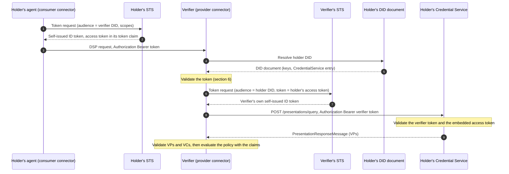
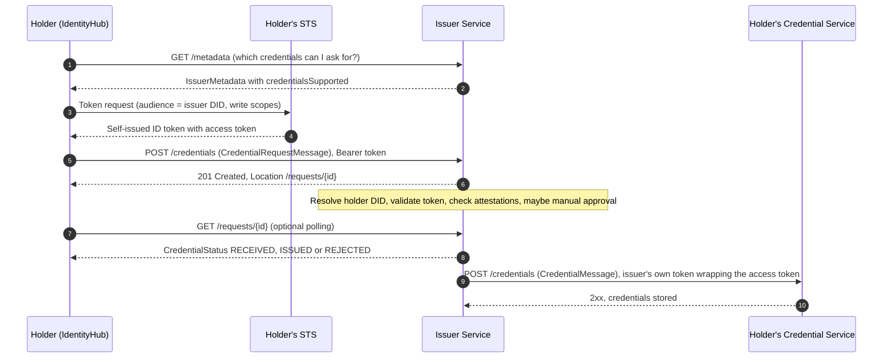
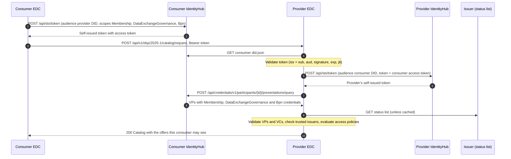

# Decentralized Claims Protocol (DCP): Developer Guide

As of 10 October 2026 · covers DCP v1.0.1

## 1. How to use this guide

This guide covers what a developer needs to know about the Decentralized Claims Protocol: the identity building blocks underneath it, every token, message and endpoint it defines, how trust and consent work, and how EDC, Tractus-X EDC, IdentityHub and the IssuerService implement it. The [Backend Team Primer](Catena-X%20%26%20Tractus-X%20Backend%20Team%20Primer.md) introduces the same ground in three short sections (5, 7 and 10); read those first if you are new. DCP is the identity layer under the Dataspace Protocol, so the [DSP Learning Guide](dataspace-protocol-guide.md) is the natural companion.

Read sections 2–4 for the big picture, history and vocabulary, and section 5 for DIDs, credentials and presentations. Sections 6–10 walk through the specification: self-issued tokens, the presentation protocol, the issuance protocol, the trust model and the profiles. Sections 11–13 cover the implementations and a full request traced end to end, and sections 14–16 cover conformance testing, debugging and further reading.

Sections 6–10 restate the [DCP v1.0.1 specification](https://eclipse-dataspace-dcp.github.io/decentralized-claims-protocol/v1.0.1/) from its [source repository](https://github.com/eclipse-dataspace-dcp/decentralized-claims-protocol) at tag `v1.0.1`. Statements about implementations were checked against the source of EDC v0.17.0, tractusx-edc 0.13.0, IdentityHub v0.17.0 and tractusx-identityhub 0.4.1, the versions that ship in Tractus-X 26.09.

## 2. DCP in one page

DSP lets two connectors negotiate and transfer data, but it says nothing about who the caller is: every DSP request carries an `Authorization` header whose content DSP leaves undefined. DCP fills that gap. It defines what goes in the header, how the receiver checks it, how the receiver then fetches the caller's credentials, and how participants obtain those credentials in the first place. It does this without a central identity provider: each participant signs its own tokens and keeps its own credentials.

DCP has three parts:

| Part | Question it answers | Who talks to whom |
| --- | --- | --- |
| Base concepts: self-issued ID tokens | How do I prove "I am this DID" on a request? | A participant agent and its own Secure Token Service (STS); the token then travels on the DSP request |
| Verifiable Presentation Protocol | How does a verifier fetch the credentials it needs from me? | Verifier → holder's Credential Service |
| Credential Issuance Protocol | How do I get credentials from an issuer, and how do they reach my wallet? | Holder → Issuer Service, then Issuer Service → holder's Credential Service |

The design rests on a few choices that explain most of its details:

- **Every participant is a DID.** DCP requires the DSP participant identifier to be a DID. Public keys and service addresses are found by resolving it.
- **Self-issued tokens.** A participant authenticates with a JWT it signs itself. The verifier checks the signature against the key in the caller's DID document.
- **Credentials are fetched, not sent.** The token carries only an opaque access token. The verifier uses it to pull a Verifiable Presentation from the caller's Credential Service in a separate call, because presentations are too large for HTTP headers and because a verifier may need to re-check credentials later without the caller's involvement.
- **Consent through scopes.** The holder decides in advance which credentials the verifier may read, by asking its STS for an access token limited to those scopes.
- **Trust is a list.** A verifier accepts a credential only if its issuer is on the verifier's list of trusted issuers. There can be several trust anchors in one dataspace.
- **Machine to machine.** No human approves anything. That is the main reason DCP exists alongside OpenID for Verifiable Credentials, which assumes a user in the loop.

DCP deliberately leaves out:

- **Registration and onboarding** of participants, which belong to the dataspace's governance authority.
- **Which credentials a policy needs.** Mapping DSP offers and agreements to required credentials is dataspace-specific (section 9).
- **How trusted issuer lists and participant lists are distributed.**
- **The STS interface.** The spec only sketches a non-normative OAuth 2 client credentials API (section 6).
- **The verifiable data registry** behind DID resolution and credential schemas.

## 3. Versions and history

DCP started inside Eclipse Tractus-X and the EDC project as the **Identity and Trust Protocol (IATP)**, which is why older code, config and endpoints still say `iatp`. It was published as version 0.8 and later moved to its own Eclipse project, the [Eclipse Dataspace Decentralized Claims Protocol](https://projects.eclipse.org/projects/technology.dataspace-dcp), under the Eclipse Dataspace Working Group.

| Version | Date | Notes |
| --- | --- | --- |
| 0.8.0, 0.8.1 | 26 Feb 2024, 15 Mar 2024 | Tractus-X era. Namespace `https://w3id.org/tractusx-trust/v0.8/`, scope alias `org.eclipse.tractusx.vc.type`. Spoken by Jupiter-era Catena-X connectors |
| 1.0 RC1–RC4 | Jan–Jun 2025 | Release candidates in the Eclipse project, created on 5 Jun 2024 |
| [1.0.0](https://eclipse-dataspace-dcp.github.io/decentralized-claims-protocol/v1.0/) | Eclipse release 18 Jul 2025 | First Eclipse release. New namespace, profiles, reworked issuance protocol |
| [1.0.1](https://eclipse-dataspace-dcp.github.io/decentralized-claims-protocol/v1.0.1/) | 12 Nov 2025 | Maintenance release: uppercase RFC 2119 keywords, "Dataspace Authority" renamed "Dataspace Governance Authority", clearer flow descriptions, and a clarification of what happens when a verifier asks for more scopes than it may read |

Dates come from the repository tags and the [project's governance page](https://projects.eclipse.org/projects/technology.dataspace-dcp/governance). The `main` branch has had small fixes since 1.0.1, such as consistent naming of the STS, but no new release. On 2 December 2025 the Eclipse Foundation announced that DCP and DSP will go to ISO/IEC JTC 1 through the Publicly Available Specification route ([announcement](https://newsroom.eclipse.org/node/43194)); as of 10 October 2026 we found no announcement that this has finished.

### What changed from 0.8 to 1.0

| Aspect | 0.8 | 1.0 |
| --- | --- | --- |
| JSON-LD namespace | `https://w3id.org/tractusx-trust/v0.8/` | `https://w3id.org/dspace-dcp/v1.0/`, context `https://w3id.org/dspace-dcp/v1.0/dcp.jsonld` |
| Required scope alias | `org.eclipse.tractusx.vc.type:<Type>:read` | `org.eclipse.dspace.dcp.vc.type:<Type>` (and `org.eclipse.dspace.dcp.vc.id:<id>`) |
| Credential formats | Not pinned down | Two named **profiles**, `vc20-bssl/jwt` and `vc11-sl2021/jwt`, plus a homogeneity rule (section 10) |
| Issuance | A credential request endpoint and an offer endpoint | Adds the Issuer Metadata and Credential Request Status APIs, `holderPid`/`issuerPid` correlation and the `CredentialObject` type |
| Revocation | — | BitstringStatusList is mandatory for issuers |

In Catena-X both still matter. Tractus-X EDC 0.13.0 speaks DCP 1.0 messages but keeps requesting credentials with the 0.8-era scope alias `org.eclipse.tractusx.vc.type`, and tractusx-identityhub accepts both aliases (sections 11 and 12).

## 4. Terminology

### 4.1 Terms the specification defines

| Term | Meaning |
| --- | --- |
| Claim | An assertion about a subject, such as "holds BPNL x" |
| Subject | The entity a credential's claims are about. In a dataspace, a participant |
| Issuer | An entity that asserts claims about subjects by issuing verifiable credentials |
| Holder | An entity that possesses credentials, usually their subject |
| Verifier | An entity that receives credentials, usually inside a presentation, and checks them |
| Verifiable Credential (VC) | A tamper-evident credential whose authorship can be verified cryptographically |
| Verifiable Presentation (VP) | A tamper-evident wrapper around one or more VCs, signed by the holder |
| DID | A decentralized identifier per W3C DID Core |
| Resource | Anything a Credential Service manages, such as a VC or VP |
| Verifiable Data Registry | Where identifiers (DIDs) and credential schemas are maintained |
| Dataspace | A policy-based data sharing context between two or more entities |
| Dataspace Governance Authority | Runs the dataspace: registers participants and designates which issuers are trusted |
| Participant | A member of the dataspace. Its roles are attested by credentials |
| Participant Agent | A system acting for a participant, such as a connector |
| Identity Provider | Generates the identity tokens that prove a participant agent's identity. In DCP each participant runs its own |
| Credential Issuer | Issues the credentials participant agents use for access and usage control |
| Registration System | The governance authority's onboarding system. Out of scope |
| Secure Token Service (STS) | Creates self-issued tokens for the participant's own agents |
| Credential Service (CS) | Stores a participant's credentials and serves presentations from them |
| DID Service (DIDS) | Creates, signs and publishes the participant's DID document |
| Issuer Service (IS) | Run by a trust anchor: issues credentials, manages revocation lists, publishes verification keys |

### 4.2 Terms used in tokens, messages and endpoints

| Term | Meaning |
| --- | --- |
| Self-Issued ID Token | A JWT a participant signs with its own key to authenticate, with `iss` = `sub` = its DID |
| Access token, `token` claim | An opaque token inside the self-issued ID token that lets the verifier read specific credentials from the holder's Credential Service |
| Scope | A string naming what the access token allows, such as `org.eclipse.dspace.dcp.vc.type:MembershipCredential` |
| `bearer_access_scope` | The STS request parameter (in the non-normative OAuth API) that lists the scopes the access token should cover |
| Presentation Definition, Presentation Submission | DIF Presentation Exchange documents: what to present, and how the response matches it. Optional in DCP |
| Profile | A named combination of VC data model, revocation system and proof format, such as `vc11-sl2021/jwt` |
| Homogeneity | The rule that a presentation contains only credentials of one data model and proof type |
| Holder binding | Checking that the credential's subject is the DID that signed the presentation |
| Trust anchor | An issuer whose credentials verifiers accept |
| Status list | A published credential containing a bit array, where each issued credential owns one bit that marks it revoked or suspended |
| `holderPid`, `issuerPid` | The holder's and the issuer's identifiers for one issuance request, like DSP's `consumerPid` and `providerPid` |
| CredentialObject | An issuer's description of one credential it can issue: type, schema, profile, binding methods and issuance policy |
| `credentialsSupported` | The list of CredentialObjects in the issuer's metadata |
| Issuance policy | A Presentation Definition saying which credentials the holder must already have to be issued this one |
| Pre-authorized code | An optional claim in the holder's token that carries an issuer-provided code |

### 4.3 DID and W3C terms you meet constantly

| Term | Meaning |
| --- | --- |
| DID document | The JSON document a DID resolves to: public keys (verification methods), verification relationships and service entries |
| `did:web` | A DID method that resolves over HTTPS: `did:web:example.com:acme` → `https://example.com/acme/did.json`, and a bare domain `did:web:example.com` → `https://example.com/.well-known/did.json` |
| Verification method | A public key in a DID document, usually `JsonWebKey2020` with a `publicKeyJwk` |
| `kid` | The JWT header naming which verification method signed the token |
| `capabilityInvocation` | The verification relationship a key needs to sign self-issued ID tokens |
| `authentication` | The verification relationship a key needs to sign presentations |
| Service entry | An endpoint advertised in the DID document. DCP uses types `CredentialService` and `IssuerService` |
| VC Data Model 1.1, 2.0 | The two W3C credential formats. 1.1 uses `issuanceDate`/`expirationDate`, 2.0 uses `validFrom`/`validUntil` |
| StatusList2021, BitstringStatusList | The two revocation list formats, used by the 1.1 and 2.0 profiles respectively |

### 4.4 Implementation vocabulary mapped to DCP

| Term in EDC, IdentityHub or Tractus-X | What it is in DCP terms |
| --- | --- |
| IdentityHub | Credential Service + DID Service + STS for one or many participants |
| IssuerService | Issuer Service |
| Participant context | One holder (or issuer) identity inside IdentityHub: its DID, keys, credentials and API key |
| Trusted issuer (`dcp.trustedIssuers`, `edc.iam.trustedissuer.*`) | The verifier's list of trust anchors, optionally limited to credential types |
| Default scopes | Scopes the connector always grants on outgoing DSP requests, whatever the policy says |
| Scope extractor | Code that turns policy constraints into the scopes the connector requests |
| DIV (formerly DIM) | The SAP-operated managed wallet used in Catena-X production. It plays the STS and Credential Service roles |
| Attestation, credential definition | IssuerService configuration: how to verify a holder's claims, and how to build a credential from them |
| VP cache | Tractus-X's cache of presentations already fetched from a counter-party |

## 5. Identity building blocks

### DIDs and DID documents

DCP requires every participant to be identified by a DID, and Catena-X uses `did:web`. Resolving the DID gives the verifier the keys to check signatures and the address of the participant's Credential Service. A DID document shaped to DCP's rules looks like this (illustrative):

```json
{
  "@context": ["https://www.w3.org/ns/did/v1", "https://w3id.org/dspace-dcp/v1.0/dcp.jsonld"],
  "id": "did:web:wallet.example.com:acme",
  "verificationMethod": [
    {
      "id": "did:web:wallet.example.com:acme#key-1",
      "type": "JsonWebKey2020",
      "controller": "did:web:wallet.example.com:acme",
      "publicKeyJwk": { "kty": "EC", "crv": "P-256", "x": "...", "y": "..." }
    }
  ],
  "authentication": ["did:web:wallet.example.com:acme#key-1"],
  "capabilityInvocation": ["did:web:wallet.example.com:acme#key-1"],
  "service": [
    {
      "id": "did:web:wallet.example.com:acme#credential-service",
      "type": "CredentialService",
      "serviceEndpoint": "https://wallet.example.com/api/credentials/v1/participants/acme"
    }
  ]
}
```

Four things in it matter to DCP:

- **`id`** must equal the `sub` of every token the participant signs.
- **A key with the `capabilityInvocation` relationship** signs self-issued ID tokens.
- **A key with the `authentication` relationship** signs presentations.
- **A `CredentialService` entry** whose `serviceEndpoint` is the base URL verifiers append `/presentations/query` to.

Issuers publish an `IssuerService` entry the same way. A DSP connector can also be listed here, as a `DataService` entry (DSP guide section 5).

### Verifiable credentials

A credential is a signed statement by an issuer about a subject. Under the `vc11-sl2021/jwt` profile it is a JWT whose payload carries the credential in a `vc` claim. Decoded, a membership credential might look like this (illustrative):

```json
{
  "iss": "did:web:issuer.example.com",
  "sub": "did:web:wallet.example.com:acme",
  "nbf": 1767225600,
  "exp": 1798761600,
  "jti": "urn:uuid:5c1b9a36-8f0e-4c5e-9f2b-2d1c7e6a4b10",
  "vc": {
    "@context": ["https://www.w3.org/2018/credentials/v1"],
    "type": ["VerifiableCredential", "MembershipCredential"],
    "issuer": "did:web:issuer.example.com",
    "issuanceDate": "2026-01-01T00:00:00Z",
    "expirationDate": "2027-01-01T00:00:00Z",
    "credentialSubject": {
      "id": "did:web:wallet.example.com:acme",
      "holderIdentifier": "BPNL000000000001"
    },
    "credentialStatus": {
      "id": "https://issuer.example.com/statuslist/1#4711",
      "type": "StatusList2021Entry",
      "statusPurpose": "revocation",
      "statusListIndex": "4711",
      "statusListCredential": "https://issuer.example.com/statuslist/1"
    }
  }
}
```

The fields a verifier relies on:

- **The issuer**, whose DID must be on the verifier's trusted list.
- **The subject**, which must be the participant presenting it.
- **The validity period.**
- **The status entry**, which points to the bit in the issuer's status list that marks the credential as revoked.

Catena-X defines its credential types and schemas in [CX-0050](https://catenax-ev.github.io/docs/standards/CX-0050-CXSpecificCredentials/CX-0050-CatenaXSpecificVerifiableCredentials); the primer's section 5 lists them.

### Verifiable presentations

A presentation wraps one or more credentials and is signed by the **holder**. The issuer's signature on each credential proves the claims are genuine; the holder's signature on the presentation proves the presenter controls the subject DID, so a copied credential is useless on its own. Under DCP's homogeneity rule a presentation contains only credentials of one format, so a holder with both VC 1.1 and VC 2.0 credentials returns two presentations.

### Revocation

Issuers MUST support revocation with BitstringStatusList (the 1.1 profile uses its predecessor, StatusList2021). The issuer publishes a status list credential: a compressed bit array where each issued credential owns one index. To check a credential, the verifier downloads the list named in `statusListCredential` and reads the bit at `statusListIndex`. Verifiers cache these lists, so a revocation takes effect only when the cache expires (section 11).

## 6. Self-issued ID tokens

### Claims

A self-issued ID token is a JWT signed with a private key the participant controls.

| Claim | Required | Rule |
| --- | --- | --- |
| `iss` | Yes | The participant's own DID |
| `sub` | Yes | Same value as `iss` |
| `aud` | Yes | The verifier's DID |
| `jti` | Yes | A unique id; the verifier rejects any value it has seen before (replay protection) |
| `exp` | Yes | Expiry, in seconds since the epoch. Verifiers may allow some clock-skew leeway |
| `iat` | Yes | Issue time, in seconds since the epoch. Lets verifiers reject very old tokens and limit how long they store `jti` values |
| `nbf` | No | Not-before time; checked if present |
| `token` | No | The opaque access token for the holder's Credential Service. Verifiers treat it as a string they pass on, not something they parse |
| `pre-authorized_code` | No | Only in issuance requests to issuers that support a pre-authorization flow |

Decoded, a consumer's token on a DSP request looks like this (illustrative):

```json
{ "alg": "ES256", "typ": "JWT", "kid": "did:web:consumer.example.com#key-1" }
.
{
  "iss": "did:web:consumer.example.com",
  "sub": "did:web:consumer.example.com",
  "aud": "did:web:provider.example.com",
  "jti": "0f9d2c7e-4d1a-4b8e-9a63-6e2f1c0b7a55",
  "iat": 1791640800,
  "exp": 1791641100,
  "token": "eyJhbGciOiJFUzI1NiJ9...opaque..."
}
```

### How a verifier validates one

The spec prescribes these checks, in order:

1. `iss` and `sub` are the same DID.
2. `aud` is the verifier's own DID.
3. The signature verifies with a key from the DID document that `sub` resolves to, and that key has the `capabilityInvocation` relationship. Key selection follows the `kid` header: if `kid` is set, use that verification method; if not, use the single verification method if there is exactly one, and reject the token if there are several.
4. `sub` equals the `id` of the resolved DID document.
5. `nbf`, if present, has passed.
6. `exp` has not passed.
7. `jti` has not been used before.

### Getting a token from the STS

How an agent obtains its token is implementation-specific, but the spec describes a non-normative OAuth 2 client credentials API, and both EDC and IdentityHub follow it:

```http
POST /token
Content-Type: application/x-www-form-urlencoded

grant_type=client_credentials&client_id=acme&client_secret=...&audience=did:web:provider.example.com&bearer_access_scope=org.eclipse.dspace.dcp.vc.type:MembershipCredential:read
```

| Parameter | Used by | Effect |
| --- | --- | --- |
| `audience` | Everyone | Becomes the `aud` claim |
| `bearer_access_scope` | The holder, before calling a verifier | The STS mints an access token limited to these space-separated scopes and puts it in the `token` claim. Without it, no `token` claim is added |
| `token` | The verifier, before calling the holder's Credential Service | The STS copies the given value into the `token` claim. This is how a verifier passes the holder's access token back to the holder's wallet inside a token of its own |

The response is an ordinary OAuth token response whose `access_token` is the signed self-issued ID token.

## 7. Verifiable Presentation Protocol

### Presentation flow

This is what happens on every DSP request between two participants that use DCP.



Two details are easy to miss. The verifier never calls the Credential Service with the holder's token directly: it wraps the holder's access token in a token it signs itself, so the Credential Service can check both who is asking and what they were allowed to see (proof of possession). And the access token is bound to this verifier, so another party that intercepts it cannot use it.

### Finding the Credential Service

The holder's DID document MUST contain a `service` entry of type `CredentialService`, and its `serviceEndpoint` is the Credential Service's base URL. All endpoint paths below are relative to it, and the base URL MUST use HTTPS.

### Resolution API

| | |
| --- | --- |
| Sent by | Verifier |
| Request | `POST <credential service base>/presentations/query` with a PresentationQueryMessage |
| Authorization | `Authorization: Bearer <verifier's self-issued ID token>`, whose `token` claim holds the holder's access token |
| Success | 2xx with a PresentationResponseMessage |
| Not authorized | 4xx; the exact code is up to the implementation |

**PresentationQueryMessage**:

```json
{
  "@context": ["https://w3id.org/dspace-dcp/v1.0/dcp.jsonld"],
  "type": "PresentationQueryMessage",
  "scope": ["org.eclipse.dspace.dcp.vc.type:MembershipCredential"]
}
```

| Field | Required | Rule |
| --- | --- | --- |
| `@context`, `type` | Yes | `type` is `PresentationQueryMessage` |
| `scope` | One of the two | A non-empty array of scopes. An empty array MUST get a 4xx |
| `presentationDefinition` | One of the two | A DIF Presentation Exchange definition. Optional to support; a service that does not support it MUST answer 501 Not Implemented |

Sending both `scope` and `presentationDefinition` is an error and MUST get a 400. In practice everyone uses scopes: EDC's verifier sends scopes, and IdentityHub answers a Presentation Definition with 501.

**Scopes** have the form `[alias]:[discriminator]`. Two aliases MUST be supported:

| Alias | Example | Grants |
| --- | --- | --- |
| `org.eclipse.dspace.dcp.vc.type` | `org.eclipse.dspace.dcp.vc.type:MembershipCredential` | Read access to credentials of that type |
| `org.eclipse.dspace.dcp.vc.id` | `org.eclipse.dspace.dcp.vc.id:8247b87d-8d72-47e1-8128-9ce47e3d829d` | Read access to the credential with that id |

Other aliases may be implementation-specific, and implementations commonly add a third segment for the operation, such as `:read` (section 11). If the query asks for scopes the caller is not entitled to, the Credential Service MUST still answer 2xx, with fewer presentations than requested. The verifier is the one that notices something is missing.

**PresentationResponseMessage**:

```json
{
  "@context": ["https://w3id.org/dspace-dcp/v1.0/dcp.jsonld"],
  "type": "PresentationResponseMessage",
  "presentation": ["eyJhbGciOiJFUzI1NiIsImtpZCI6..."]
}
```

`presentation` is an array of VPs, as JWT strings, JSON objects or both depending on the format. It SHOULD contain only valid credentials (not expired, revoked or suspended). If the query used a Presentation Definition, a `presentationSubmission` must be included.

### How a verifier validates the presentations

1. The presentations match what was asked for in `scope` (or the Presentation Definition).
2. Each presentation's signature verifies with the key named by its verification method, resolved from the holder's DID.
3. That verification method has the `authentication` relationship.
4. For each credential, the DID in its verification method equals its `issuer`.
5. Each credential's signature verifies with the issuer's key.
6. If a credential has a status entry, the status list says it is not revoked.
7. Any expiry or validity claims on the presentation hold.
8. If any check fails, the presentation is invalid.

When the dataspace requires holder binding, the verifier also checks that each credential's `credentialSubject.id` equals the DID that signed the presentation. Finally, the verifier must trust each credential's issuer (section 9). The resulting claims are what the policy engine evaluates.

## 8. Credential Issuance Protocol

### Issuance flow

Issuance is asynchronous: the holder asks, the issuer acknowledges, and the credential arrives later as a separate call into the holder's Credential Service.



### Finding the Issuer Service

An issuer's DID document MUST contain a `service` entry of type `IssuerService`; its `serviceEndpoint` is the base URL for the issuer endpoints below.

### Issuance endpoints

| Side | Method and path | Message | Response |
| --- | --- | --- | --- |
| Issuer | `GET /metadata` | — | 200 with IssuerMetadata |
| Issuer | `POST /credentials` | CredentialRequestMessage | 201 with a `Location` header pointing at the request status; 401 or other 4xx on failure |
| Issuer | `GET /requests/{id}` | — | 200 with CredentialStatus. Only the requester may read it, authenticated with a self-issued token |
| Holder (Credential Service) | `POST /credentials` | CredentialMessage (Storage API) | 2xx, or 4xx if not authorized |
| Holder (Credential Service) | `POST /offers` | CredentialOfferMessage | 200, or 4xx |

### Issuance messages

**IssuerMetadata** lists what the issuer can issue. Every entry in `credentialsSupported` is a complete CredentialObject:

```json
{
  "@context": ["https://w3id.org/dspace-dcp/v1.0/dcp.jsonld"],
  "type": "IssuerMetadata",
  "issuer": "did:web:issuer-url",
  "credentialsSupported": [
    {
      "id": "d5c77b0e-7f4e-4fd5-8c5f-28b5fc3f96d1",
      "type": "CredentialObject",
      "credentialType": "CompanyCredential",
      "credentialSchema": "https://example.com/company-credential-schema.json",
      "bindingMethods": ["did:web"],
      "profile": "vc11-sl2021/jwt",
      "offerReason": "reissue",
      "issuancePolicy": { "id": "Scalable trust example", "input_descriptors": [] }
    }
  ]
}
```

The spec's own examples write the profile as `vc10-sl2021/jwt`; the alias the spec actually defines is `vc11-sl2021/jwt`. The `issuancePolicy` is shortened here. In full it is a Presentation Definition naming the credentials the holder must already hold.

**CredentialRequestMessage** asks for one or more of those credentials by `id`:

```json
{
  "@context": ["https://w3id.org/dspace-dcp/v1.0/dcp.jsonld"],
  "type": "CredentialRequestMessage",
  "holderPid": "holderPid",
  "credentials": [{ "id": "d5c77b0e-7f4e-4fd5-8c5f-28b5fc3f96d1" }]
}
```

The request carries the holder's self-issued token as a bearer token. If that token has a `token` claim, it is the write access token for the holder's Credential Service, and the issuer MUST use it when delivering. The issuer may also use it to fetch presentations the holder needs for issuance.

**CredentialMessage** delivers the result to the holder's Credential Service:

```json
{
  "@context": ["https://w3id.org/dspace-dcp/v1.0/dcp.jsonld"],
  "type": "CredentialMessage",
  "issuerPid": "issuerPid",
  "holderPid": "holderPid",
  "status": "ISSUED",
  "credentials": [
    { "credentialType": "MembershipCredential", "payload": "<JWT-STRING>", "format": "jwt" }
  ]
}
```

`status` is `ISSUED` or `REJECTED` and applies to the whole request: if any credential could not be issued, the request is rejected. A rejection may carry a `rejectionReason`, which should not disclose confidential information.

**CredentialStatus** (from `GET /requests/{id}`) reports `RECEIVED`, `ISSUED` or `REJECTED`, with both `issuerPid` and `holderPid`.

**CredentialOfferMessage** lets an issuer start the conversation, for example when a credential must be reissued after a key rotation. It names the issuer and lists CredentialObjects, which may be sparse (only an `id`) and are then completed from the issuer's metadata. `offerReason` values include `reissue` and `proof-key-revocation`.

### CredentialObject fields

| Field | Meaning |
| --- | --- |
| `id`, `type` | Stable identifier of this issuable credential; `type` is `CredentialObject`. The only required fields, but metadata entries must have all of them |
| `credentialType` | The VC type, such as `MembershipCredential` |
| `credentialSchema` | URL of the JSON schema for the `credentialSubject` |
| `bindingMethods` | How the credential is bound to the holder, such as `did:web` |
| `profile` | The profile alias the credential uses |
| `issuancePolicy` | Presentation Definition of credentials the holder must present first |
| `offerReason` | Why it is being offered |

### Key rotation and revocation at the issuer

Issuers SHOULD support both:

- **Rotation:** add a new key to the issuer's DID document and sign new credentials with it. Keep the old public key published until every credential it signed has expired, then remove it, optionally offering reissued credentials beforehand. Credential lifetimes should therefore be shorter than the key rotation period.
- **Revocation of a compromised key:** remove its verification method immediately. Every credential it signed becomes invalid at once, and the issuer may offer replacements with `offerReason` `proof-key-revocation`.

## 9. Trust model and consent

DCP follows the W3C issuer–holder–verifier model. The issuer signs credentials and gives them to the holder, the holder decides what to present, and the verifier decides what to accept. All three rely on the verifiable data registry for DIDs and schemas, and all communication MUST use HTTPS.

**Consent** works without a human:

1. The dataspace defines which credentials each kind of DSP offer or agreement requires. The spec expects the governance authority to publish these mappings.
2. When the holder's agent sends a DSP message, it works out the required credentials and asks its STS for an access token covering exactly those. That access token is the holder's consent.
3. The verifier performs the same mapping on receipt, queries the Credential Service with the access token, and grants access only if the presentations satisfy the requirements. That is the verifier's consent.

Both sides must arrive at the same mapping. If the holder grants fewer scopes than the verifier asks for, the verifier receives an incomplete presentation and refuses.

**Trust relationships**:

| Party | Expects |
| --- | --- |
| Everyone | A tamper-evident registry, revocable tamper-proof credentials, TLS on every call |
| Issuer | The Credential Service stores credentials securely and does not leak them |
| Holder | A secure list of trusted issuer DIDs and of participant DIDs from the governance authority; issuers that bind credentials correctly; verifiers that do not pass data on |
| Verifier | A secure list of trusted issuer DIDs (possibly from several governance authorities); issuers that bind credentials correctly |

How these lists are distributed is out of scope. In EDC the trusted issuer list is plain configuration (section 11), which also makes it the main control for accepting credentials from more than one dataspace.

## 10. Profiles, formats and the wire format

### Profiles

| Alias | VC data model | Revocation | Proof |
| --- | --- | --- | --- |
| `vc20-bssl/jwt` | VC Data Model 2.0 | BitstringStatusList | Enveloped proof with JOSE (the whole VC is the JWT payload). Use `validUntil`, ignore the status list's `ttl` |
| `vc11-sl2021/jwt` | VC Data Model 1.1 | StatusList2021 | External proof as a JWT (the VC sits in the `vc` claim) |

Neither profile pins a signature algorithm; implementations are expected to handle the common RSA, EC and EdDSA algorithms. Neither supports encrypted JWTs (JWE). Credentials MUST be homogeneous within a presentation: same data model and same proof mechanism for the credentials and the presentation that wraps them. Authors of new profiles must specify at least the data model, the revocation system and the proof stack.

### JSON-LD and schemas

As in DSP, JSON Schema is normative and the JSON-LD context `https://w3id.org/dspace-dcp/v1.0/dcp.jsonld` compacts messages into schema-valid JSON, so messages can be handled as plain JSON. Future versions will use `vMAJOR.MINOR` in the namespace. Message types use a plain `type` field (`PresentationQueryMessage`, `CredentialRequestMessage`, ...), not `@type`.

## 11. DCP in EDC and Tractus-X EDC

The connector plays two DCP roles: it is the holder's agent when it sends DSP requests, and the verifier when it receives them.

### As the caller (consumer side)

1. EDC works out which scopes the outgoing DSP message needs, from two sources. **Scope extractors** turn constraints in the policies about to be evaluated into scopes, and **default scopes** are always added.
2. It asks its STS for a self-issued token with `aud` set to the counter-party's DID (`counterPartyId`) and those scopes in `bearer_access_scope`.
3. It sends the DSP request with `Authorization: Bearer <token>`.

### As the receiver (provider side)

EDC's identity service ([source](https://github.com/eclipse-edc/Connector/blob/v0.17.0/extensions/common/iam/decentralized-claims/decentralized-claims-service/src/main/java/org/eclipse/edc/iam/decentralizedclaims/service/DcpIdentityService.java)) does the following on every DSP request:

1. Rejects the request unless the header starts with `Bearer` followed by a space.
2. Validates the self-issued token as in section 6, including `jti` replay protection.
3. Reads the consumer's access token from the `token` claim.
4. Asks its own STS for a token with `iss` = `sub` = its own DID, `aud` = the consumer's DID and `token` = the consumer's access token ([source](https://github.com/eclipse-edc/Connector/blob/v0.17.0/extensions/common/iam/decentralized-claims/lib/decentralized-claims-lib/src/main/java/org/eclipse/edc/iam/decentralizedclaims/lib/DefaultPresentationRequestService.java)).
5. Resolves the consumer's DID, finds the `CredentialService` entry, and sends a PresentationQueryMessage with the scopes its own policies need.
6. Fails if fewer credentials come back than scopes were requested, or if any requested type is missing ("Not all requested credentials are present in the presentation response").
7. Validates every credential: signature, validity period, revocation status, issuer on the trusted list, subject ids.
8. Fails unless every presentation's holder equals the token's `iss`.
9. Hands the credentials' claims to the policy engine.

### Upstream EDC settings

| Setting | Purpose |
| --- | --- |
| `edc.iam.issuer.id` | The connector's own DID |
| `edc.iam.sts.oauth.token.url`, `edc.iam.sts.oauth.client.id`, `edc.iam.sts.oauth.client.secret.alias` | Where and how to get self-issued tokens from a remote STS (OAuth 2 client credentials; the secret lives in the vault) |
| `edc.iam.trustedissuer.<alias>.id` | A trusted issuer DID. The older prefix `edc.iam.trusted-issuer` still works but logs a deprecation warning |
| `edc.iam.trustedissuer.<alias>.supportedtypes` | JSON list of credential types accepted from that issuer |
| `edc.iam.did.web.use.https` | Whether `did:web` is resolved over HTTPS. Keep it on outside local tests |
| `edc.iam.accesstoken.jti.validation` | Replay protection for tokens. Default `true` |
| `edc.iam.credential.revocation.cache.validity` | How long fetched status lists are cached. Default 15 minutes |

Upstream EDC has no built-in mapping from policy constraints to scopes; each dataspace registers its own scope extractors. Its examples, like IdentityHub, write scopes as `org.eclipse.dspace.dcp.vc.type:<Type>:<operation>`, for example `org.eclipse.dspace.dcp.vc.type:MembershipCredential:read`: the spec's alias and discriminator plus an operation segment. A Management API catalog request can also pass `additionalScopes` to grant extra scopes for that one call. EDC ships revocation checks for both StatusList2021 and BitstringStatusList.

### What Tractus-X EDC adds

- **The Catena-X scope alias.** Tractus-X requests credentials as `org.eclipse.tractusx.vc.type:<Type>:read`, the 0.8-era alias, which Catena-X wallets understand ([constants](https://github.com/eclipse-tractusx/tractusx-edc/blob/0.13.0/spi/core-spi/src/main/java/org/eclipse/tractusx/edc/TxDcpConstants.java)).
- **Default scopes per DSP version.** Every catalog, contract and transfer request over DSP 2025-1 grants `MembershipCredential`, `DataExchangeGovernanceCredential` and `BpnCredential`. Over DSP 0.8 it grants only `MembershipCredential`.
- **A Catena-X scope extractor.** Policy constraints in the Catena-X policy namespace become credential scopes: a left operand `X` becomes `XCredential`, except `FrameworkAgreement`, which maps to `DataExchangeGovernanceCredential`. Only `MembershipCredential`, `BpnCredential`, `DismantlerCredential` and `DataExchangeGovernanceCredential` are recognised ([source](https://github.com/eclipse-tractusx/tractusx-edc/blob/0.13.0/edc-extensions/dcp/cx-dcp/src/main/java/org/eclipse/tractusx/edc/iam/dcp/cx/scope/CxCredentialScopeExtractor.java)).
- **Configurable extra default scopes** under `tx.edc.iam.dcp.default-scopes.<name>.alias`, `.type` and `.operation`.
- **A choice of STS.** If `tx.edc.iam.sts.div.url` is set, the connector gets tokens from the DIV wallet; otherwise it uses the standard OAuth 2 STS client, which works with IdentityHub's STS ([source](https://github.com/eclipse-tractusx/tractusx-edc/blob/0.13.0/edc-extensions/dcp/tx-dcp-sts-div/src/main/java/org/eclipse/tractusx/edc/iam/dcp/sts/RemoteTokenServiceClientExtension.java)).
- **A presentation cache.** Presentations fetched from a counter-party are cached per participant, counter-party DID and scope set, for 24 hours by default (`tx.edc.dcp.cache.enabled`, `tx.edc.dcp.cache.validity.seconds`). Cached entries are re-checked for expiry and revocation before reuse, and new entries are validated before they are stored.

In the Tractus-X Helm chart these come together under a few keys ([values](https://github.com/eclipse-tractusx/tractusx-edc/blob/0.13.0/charts/tractusx-connector/values.yaml)):

| Helm value | Meaning |
| --- | --- |
| `participant.id` | The connector's DID. Before 0.13.0 this held the BPNL and the DID sat in `iatp.id` |
| `participant.bpnl` | The BPNL, still needed for BPN-based policies and DSP 0.8 |
| `dcp.trustedIssuers` | List of issuers, each a DID or an object with `id` and `supportedTypes` (defaults to `*`) |
| `dcp.sts.div.url` | Use the DIV wallet as STS |
| `dcp.sts.oauth.token_url`, `dcp.sts.oauth.client.id`, `dcp.sts.oauth.client.secret_alias` | OAuth client for the STS |
| `dcp.cache.enabled`, `dcp.cache.validity` | The presentation cache (default on, 86,400 seconds) |
| `dcp.didService.selfRegistration.enabled` | Register the connector as a `DataService` in its own DID document (DSP guide section 10) |

## 12. IdentityHub and IssuerService

tractusx-identityhub 0.4.1, the version in Tractus-X 26.09, is built on upstream IdentityHub v0.17.0 and ships two runtimes: **IdentityHub** (Credential Service, DID Service and STS for holders) and **IssuerService** (Issuer Service). The primer's section 10 covers their resources and deployment shapes; this section covers what a developer calls.

### IdentityHub and IssuerService endpoints

From the [Tractus-X DCP API walkthrough](https://github.com/eclipse-tractusx/tractusx-identityhub/tree/v0.4.1/docs/usage/dcp-api-walkthrough), with Helm chart ports:

| Runtime | API | Path | Port | Exposure | Purpose |
| --- | --- | --- | --- | --- | --- |
| IdentityHub | Identity | `/api/identity` | 8082 | Internal | Manage participant contexts, DIDs, keys, credentials |
| IdentityHub | Credentials | `/api/credentials` | 8083 | Public | DCP: presentation queries, credential storage, offers |
| IdentityHub | DID | `/` | 8084 | Public | Serves DID documents |
| IdentityHub | STS | `/api/sts` | 8087 | Internal | Self-issued tokens for the participant's connector |
| IssuerService | Issuance | `/api/issuance` | 8082 | Public | DCP: metadata, credential requests, request status |
| IssuerService | Admin | `/api/admin` | 8086 | Internal | Attestations, credential definitions, holders |
| IssuerService | Identity | `/api/identity` | 8087 | Internal | The issuer's own participant context |
| IssuerService | StatusList | `/statuslist` | 8088 | Public | Revocation status lists |

The DCP endpoints sit under a participant context, which is how one IdentityHub serves many holders:

| Endpoint | Path in IdentityHub 0.17 |
| --- | --- |
| Presentation query | `/api/credentials/v1/participants/{participantContextId}/presentations/query` |
| Credential storage | `/api/credentials/v1/participants/{participantContextId}/credentials` |
| Credential offers | `/api/credentials/v1/participants/{participantContextId}/offers` |
| Issuer metadata | `/api/issuance/v1alpha/participants/{participantContextId}/metadata` |
| Credential request | `/api/issuance/v1alpha/participants/{participantContextId}/credentials` |
| Request status | `/api/issuance/v1alpha/participants/{participantContextId}/requests/{id}` |

The issuer endpoints are still versioned `v1alpha`. Since 0.17.0 the `participantContextId` in paths is the plain id; before, it was base64url-encoded, so DID documents created with older versions carry stale service URLs. Management APIs authenticate with `x-api-key: <base64url participant id>.<token>`.

### Creating a holder

One call on the Identity API creates a holder identity: a key pair in the vault, a DID document with a `CredentialService` entry, and an API key. With `active: true` the DID document is published straight away.

```bash
curl -X POST "${IDH_IDENTITY}/v1alpha/participants" \
  -H "Content-Type: application/json" \
  -H "x-api-key: ${IDH_ADMIN_KEY}" \
  -d '{
    "active": true,
    "did": "did:web:identity-hub.example.com",
    "key": {
      "keyGeneratorParams": { "algorithm": "Ec", "curve": "secp256r1" },
      "keyId": "did:web:identity-hub.example.com#key-1",
      "type": "JsonWebKey2020",
      "privateKeyAlias": "did:web:identity-hub.example.com-privatekey-alias"
    },
    "participantContextId": "idh-participant",
    "roles": ["ROLE_ADMIN", "admin"],
    "serviceEndpoints": [{
      "id": "https://identity-hub.example.com#credential-service",
      "type": "CredentialService",
      "serviceEndpoint": "https://identity-hub.example.com/api/credentials/v1/participants/idh-participant"
    }]
  }'
```

The response returns the participant's `apiKey` plus a `clientId` and `clientSecret`. Those are the STS client credentials the connector uses as `edc.iam.sts.oauth.client.id` and the vault secret behind `edc.iam.sts.oauth.client.secret.alias`.

### Which scopes IdentityHub accepts

Upstream IdentityHub accepts only `org.eclipse.dspace.dcp.vc.type:<Type>:<operation>`, with operation `read`, `*` or `all`, and rejects other aliases ([source](https://github.com/eclipse-edc/IdentityHub/blob/v0.17.0/core/common-core/src/main/java/org/eclipse/edc/identityhub/defaults/EdcScopeToCriterionTransformer.java)). tractusx-identityhub accepts both `org.eclipse.tractusx.vc.type` and `org.eclipse.dspace.dcp.vc.type` by default, configurable with `tx.identityhub.scope.aliases`. A Tractus-X connector paired with a plain upstream IdentityHub therefore fails every presentation query.

### Issuing credentials with the IssuerService

The IssuerService needs three kinds of configuration before it can issue, all through its Admin API:

| Resource | Endpoint | What it is |
| --- | --- | --- |
| Attestation | `POST /v1alpha/participants/{id}/attestations` | How to verify a holder's claims. Types: `database` (look the holder up in a table), `presentation` (require credentials the holder already has) and `external` (call another service) |
| Credential definition | `POST /v1alpha/participants/{id}/credentialdefinitions` | What to issue: `credentialType`, `format` (`VC1_0_JWT` or `VC1_0_JSON_LD`), the attestations to run, `mappings` from attestation data to `credentialSubject` fields, and `validity` in seconds |
| Holder | `POST /v1alpha/participants/{id}/holders` | A known holder: its DID, a `holderId` (the BPNL in Catena-X) and a name |

The holder then triggers issuance through its own IdentityHub, which runs the DCP flow from section 8:

```bash
curl -X POST "${IDH_IDENTITY}/v1alpha/participants/${IDH_CONTEXT}/credentials/request" \
  -H "Content-Type: application/json" \
  -H "x-api-key: ${IDH_API_KEY}" \
  -d '{
    "issuerDid": "did:web:issuer-service.example.com",
    "holderPid": "49b1cb75-30d2-4098-8f58-03c75304adc3",
    "credentials": [{ "id": "tx-membershipCredential", "type": "MembershipCredential", "format": "VC1_0_JWT" }]
  }'
```

The call returns 201 at once; the credential arrives a few seconds later and can be listed with `GET /v1alpha/participants/{id}/credentials`. The IssuerService registers each credential in a BitstringStatusList so it can be revoked. The walkthrough notes one current gap: the default `holders` table has no `member_of` column, so a mapping to `credentialSubject.memberOf` needs a custom migration.

### What Catena-X production uses today

Catena-X production does not yet run the DCP issuance flow. The CSP-B's issuer component writes credentials into each participant's DIV wallet through SAP's SSI DIM Middle Layer, and DIV acts as the participant's STS and Credential Service. The Tractus-X 26.09 release notes still describe this as a temporary bridge (primer sections 10 and 18). The presentation flow in section 7 is the same either way; only the wallet behind it differs.

## 13. End to end: one catalog request

Here is a Tractus-X consumer fetching a catalog from a Tractus-X provider over DSP 2025-1, both using IdentityHub, with every DCP step shown.



What each failure looks like from the consumer side:

- **Steps 1–2 fail (STS):** the request is never sent; the consumer's own logs show an STS or OAuth error.
- **Steps 4–5 fail (token):** EDC answers 401.
- **Steps 6–9 fail (presentation):** usually also 401.
- **Credentials valid but no policy matches:** a 200 with an empty catalog.

## 14. Conformance: the DCP TCK

The [DCP Technology Compatibility Kit](https://github.com/eclipse-dataspacetck/dcp-tck) tests Credential Service, verifier and issuance behaviour against the spec. Its first release, v1.0.0, came out on 28 May 2026, and the latest is v1.2.1 from 7 September 2026 ([releases](https://github.com/eclipse-dataspacetck/dcp-tck/releases)). tractusx-edc runs it in CI together with the DSP TCK (primer section 14). If we ever build our own wallet or verifier, for example for a dataspace outside Catena-X, this is how we prove it interoperates.

## 15. Pitfalls and debugging

1. **Empty catalog, no error.** The consumer did not grant a scope the provider needed, or a credential is missing, expired or from an untrusted issuer. Check default scopes, the consumer's credentials and the provider's trusted issuer list in that order.
2. **Scope alias mismatch.** Tractus-X EDC sends `org.eclipse.tractusx.vc.type:...`; upstream IdentityHub accepts only `org.eclipse.dspace.dcp.vc.type:...`. Use tractusx-identityhub or align `tx.identityhub.scope.aliases`.
3. **Fewer presentations than scopes.** A Credential Service answers 2xx even when it cannot serve every scope, and EDC then fails with "Not all requested credentials are present". The holder lacks that credential type or did not grant it.
4. **Wrong audience.** The token's `aud` must be the verifier's DID. In EDC that is the `counterPartyId`, so a BPN or a stale DID there fails validation.
5. **`did:web` not resolvable.** The verifier must reach `https://<host>/<path>/did.json` (or `/.well-known/did.json` for a bare domain) from the internet over HTTPS, with the right `id` inside. Test it with curl from outside your network.
6. **Stale Credential Service URL.** After upgrading to IdentityHub 0.17, DID documents may still point at base64-encoded participant paths. Check the `CredentialService` entry.
7. **Clock skew.** `exp`, `iat` and `nbf` are checked with only small leeway, so run NTP on every node.
8. **Replayed tokens.** Each `jti` is accepted once. Code that retries a DSP call must get a fresh token, not resend the old header.
9. **Key rotation.** The `kid` in a token must match a verification method in the current DID document. Removing an old key too early invalidates everything signed with it.
10. **Revocation is not instant.** EDC caches status lists for 15 minutes by default, and Tractus-X caches whole presentations for 24 hours. Cached entries are re-checked against the cached status list, so plan for minutes of delay, not seconds.
11. **Mixed credential formats.** A presentation that mixes VC 1.1 and VC 2.0 credentials is invalid. Each format needs its own presentation.
12. **Holder mismatch.** EDC rejects presentations whose holder is not the DID that signed the original token. This happens when one wallet serves several identities and returns the wrong one.

## 16. Further reading

| # | Read | Focus on |
| --- | --- | --- |
| 1 | [DCP v1.0.1 specification](https://eclipse-dataspace-dcp.github.io/decentralized-claims-protocol/v1.0.1/) | The normative text; sections 6–10 of this guide follow it |
| 2 | [DCP repository](https://github.com/eclipse-dataspace-dcp/decentralized-claims-protocol), folder `artifacts/src/main/resources` | JSON Schemas and examples for every message |
| 3 | [Tractus-X DCP API walkthrough](https://github.com/eclipse-tractusx/tractusx-identityhub/tree/v0.4.1/docs/usage/dcp-api-walkthrough) | Issuing a MembershipCredential end to end with IssuerService and IdentityHub |
| 4 | [IdentityHub documentation](https://eclipse-edc.github.io/documentation/for-adopters/identity-hub/) | Architecture, APIs and deployment |
| 5 | [CX-0050 Catena-X credentials](https://catenax-ev.github.io/docs/standards/CX-0050-CXSpecificCredentials/CX-0050-CatenaXSpecificVerifiableCredentials) and [CX-0149 wallet requirements](https://catenax-ev.github.io/docs/standards/CX-0149-WalletRequirements) | What Catena-X credentials contain and what a wallet must do |
| 6 | [W3C DID Core](https://www.w3.org/TR/did-1.0/), [VC Data Model 2.0](https://www.w3.org/TR/vc-data-model-2.0/), [BitstringStatusList](https://www.w3.org/TR/vc-bitstring-status-list/) | The standards DCP builds on |
| 7 | [DCP TCK](https://github.com/eclipse-dataspacetck/dcp-tck) | How conformance is tested |

Sources for this document are linked inline in each section. As of 10 October 2026.
